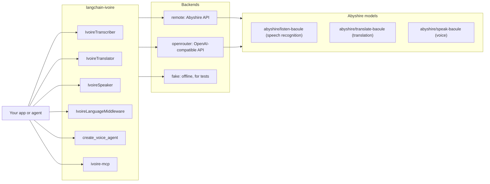
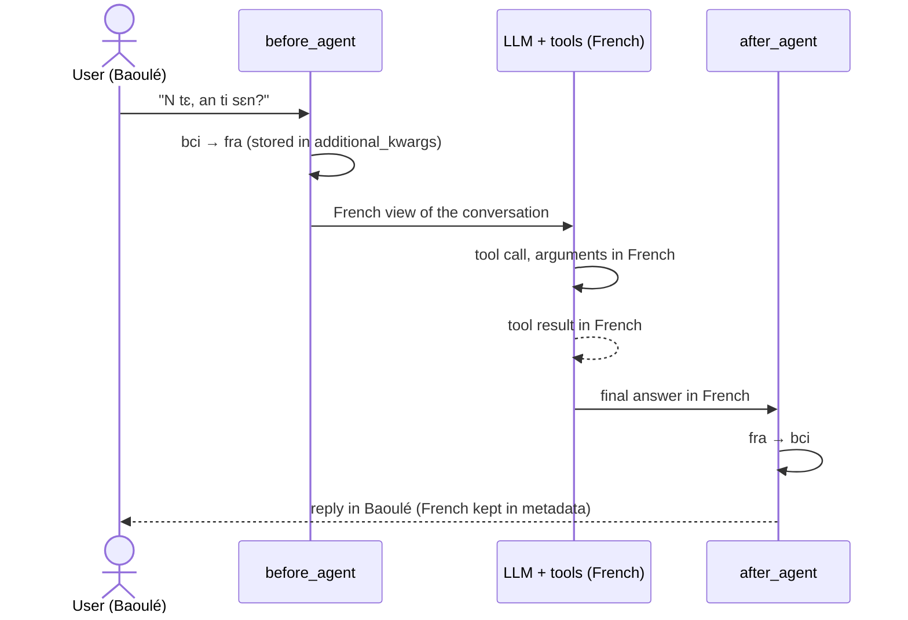
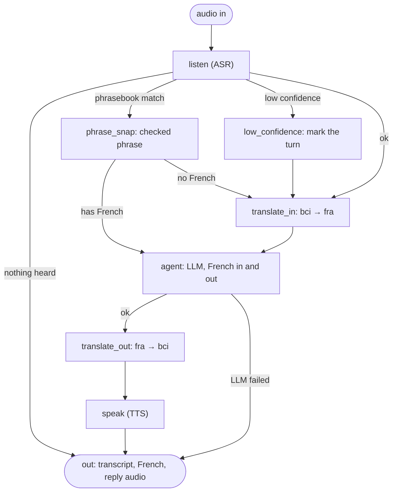
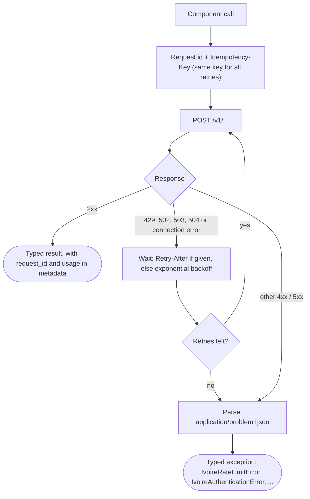
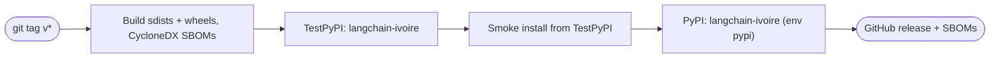

# langchain-ivoire

**Make any LangChain agent speak Baoulé — by voice.**

> [!NOTE]
> **Status: preview (`0.1.0a3`, alpha).** The hosted API is by request (translation is the public
> service; speech recognition, the voice and embeddings are by approval). Interfaces may change
> before 0.1.0.

[Install](#install) · [Quick start](#quick-start) · [Docs](docs/) · [Benchmarks](#benchmarks) ·
[MCP server](#mcp-server) · [Request an API key](#model-access-and-api-keys) ·
[3D waveform](#3d-waveform)

LangChain and LangGraph components for **Ivorian languages**, by Abyshire. **Baoulé** (ISO 639-3
`bci`) works now; Agni, Dioula and Bété are planned. This repository is a uv workspace with one
package:

| package | path | what |
|---|---|---|
| `langchain-ivoire` | [`libs/langchain-ivoire`](libs/langchain-ivoire) | the integration (user docs in its [README](libs/langchain-ivoire/README.md)) |

## Features

| component | what it does |
|---|---|
| `IvoireTranscriber` | Baoulé speech → text, with a confidence score |
| `IvoireTranslator` | Baoulé ↔ French, and ↔ English through French; `everyday`, `tale` or `formal` style |
| `IvoireSpeaker` | Baoulé text → speech (WAV) |
| `with_language(llm, lang="bci")` | any chat model takes Baoulé in and gives Baoulé back |
| `IvoireLanguageMiddleware` | any `create_agent` agent talks Baoulé; the agent and its tools work in French |
| `create_voice_agent(llm, lang="bci")` | prebuilt LangGraph voice agent: listen → translate → LLM → translate back → speak |
| `ivoire-mcp` | MCP server with transcribe, translate, speak and languages tools |
| `IvoireAudioLoader`, tools, `audio` helpers | audio files as `Document`s; agent tools; LangChain audio content blocks |

Every component is a LangChain `Runnable`: it composes with `|`, batches, retries and traces.

## How it fits together



### `IvoireLanguageMiddleware` with `create_agent`

The model and its tools only ever see French. Baoulé is translated on the way in and on the way out.



### The voice agent graph

This mirrors `create_voice_agent` in [`graph.py`](libs/langchain-ivoire/langchain_ivoire/graph.py).
The phrasebook check comes first; low-confidence turns are marked and still translated.



`speak` runs only with `speak=True` (the default); an app can use the low-confidence flag to ask the
speaker to repeat.

### Remote request lifecycle



## Install

```bash
pip install langchain-ivoire            # API client (light: langchain-core, langgraph, httpx)
pip install "langchain-ivoire[mcp]"     # + the ivoire-mcp server
```

## Quick start

The remote backend reads `IVOIRE_API_KEY` (and optionally `IVOIRE_BASE_URL`). With no key yet,
pass `backend="fake"` to run everything offline.

```python
from langchain.chat_models import init_chat_model
from langchain_ivoire import with_language

chat = with_language(init_chat_model("provider:model"), lang="bci")  # any chat model
chat.invoke("N tɛ, an ti sɛn?").content  # "Hello, how are you?" -> a Baoulé reply
```

```python
from langchain.agents import create_agent
from langchain_ivoire import IvoireLanguageMiddleware

agent = create_agent(
    "provider:model",  # any model id that init_chat_model accepts
    tools=[get_weather],
    middleware=[IvoireLanguageMiddleware("bci", max_sentences=2)],  # put it first
)
agent.invoke({"messages": [{"role": "user", "content": "N tɛ, an ti sɛn?"}]})
```

```python
from langgraph.checkpoint.memory import InMemorySaver
from langchain_ivoire import create_voice_agent
from langchain_ivoire.audio import to_audio_block

agent = create_voice_agent(
    llm, lang="bci", phrasebook="phrasebook.json", checkpointer=InMemorySaver()
)
out = agent.invoke(
    {"audio": to_audio_block(open("question.wav", "rb").read())},
    {"configurable": {"thread_id": "family-call"}},
)
out["transcript"], out["reply_fra"], out["reply"]  # plus out["reply_audio"]
```

### MCP server

```bash
ivoire-mcp                                          # stdio, for desktop MCP clients
ivoire-mcp --transport streamable-http --port 8000  # http://127.0.0.1:8000/mcp
ivoire-mcp --backend fake                           # offline
```

Tools: `ivoire_transcribe`, `ivoire_translate`, `ivoire_speak` (MCP audio content) and
`ivoire_languages`. The [package README](libs/langchain-ivoire/README.md#mcp-server-any-mcp-client)
has a client configuration example.

## Where Baoulé is spoken

Baoulé is spoken in central Côte d'Ivoire, around Bouaké and Yamoussoukro. The points are towns,
for orientation only: they are **not a language boundary**, and the dialect labels are approximate.

```geojson
{
  "type": "FeatureCollection",
  "features": [
    {"type": "Feature", "geometry": {"type": "Point", "coordinates": [-5.0308, 7.6906]},
     "properties": {"name": "Bouaké", "role": "Largest Baoulé-speaking city"}},
    {"type": "Feature", "geometry": {"type": "Point", "coordinates": [-5.2893, 6.8276]},
     "properties": {"name": "Yamoussoukro", "role": "Political capital, in the Baoulé area"}},
    {"type": "Feature", "geometry": {"type": "Point", "coordinates": [-5.5833, 7.6667]},
     "properties": {"name": "Béoumi", "role": "North-western Baoulé area (approximate)"}},
    {"type": "Feature", "geometry": {"type": "Point", "coordinates": [-5.2926, 7.4546]},
     "properties": {"name": "Sakassou", "role": "Historic seat of the Baoulé kingdom"}},
    {"type": "Feature", "geometry": {"type": "Point", "coordinates": [-5.0170, 6.5500]},
     "properties": {"name": "Toumodi", "role": "Southern Baoulé area (approximate)"}},
    {"type": "Feature", "geometry": {"type": "Point", "coordinates": [-4.7052, 6.6468]},
     "properties": {"name": "Dimbokro", "role": "Agba area (approximate)"}},
    {"type": "Feature", "geometry": {"type": "Point", "coordinates": [-4.4995, 7.0626]},
     "properties": {"name": "Bocanda", "role": "Agba area (approximate)"}},
    {"type": "Feature", "geometry": {"type": "Point", "coordinates": [-4.0083, 5.3600]},
     "properties": {"name": "Abidjan", "role": "Context: economic capital, large Baoulé-speaking community"}}
  ]
}
```

## Benchmarks

Measured **through the hosted API** on 16 Oct 2026, one item per request (details, confidence
intervals and method: [`docs/benchmarks.md`](docs/benchmarks.md)):

| model | test set | result | latency p50 / p90 |
|---|---|---|---|
| `abyshire/translate-baoule` | held-out everyday sentences, n = 716 | chrF++ **36.5** bci → fra, **37.1** fra → bci | 237 / 442 ms |
| | held-out sentences from Baoulé tales, n = 218 | chrF++ 16.1 bci → fra, 19.4 fra → bci | 373 / 608 ms |
| `abyshire/listen-baoule` | **phone recordings of speakers not seen before** | **WER 19.3 %**, CER 8.3 % | 578 / 998 ms |
| | read speech, held-out sentences | WER 16.4 %, CER 7.7 % | 645 / 825 ms |

There is no standard public test set for Baoulé yet; the sets are small, so read the confidence
intervals. The voice and the embeddings have not been benchmarked through the API yet.

## Languages

| code | language | status |
|---|---|---|
| `bci` | Baoulé | available |
| `any` | Anyin (Agni) | planned |
| `dyu` | Dioula (Jula) | planned |
| `bev` / `btg` | Bété (Daloa / Gagnoa) | planned |

Planned languages raise `NotImplementedError` with a clear message.

## Model access and API keys

- The hosted API at `https://api.abyshire.ci` needs an **API key from Abyshire**.
- **Get a key / request approval: api@abyshire.co.uk** (your name, your organisation, the intended
  use, and whether it is research or commercial).
- **Translation** (`abyshire/translate-baoule`) is public. **Speech recognition**
  (`abyshire/listen-baoule`), **the voice** (`abyshire/speak-baoule`) and **embeddings**
  (`abyshire/embed-baoule`) are **by approval**.
- **Free trial quota during the alpha** (rate-limited per key). Commercial use is subject to an
  agreement with Abyshire.
- Translation via OpenRouter (coming soon).
- The models are served through the API only.
- No key yet? `backend="fake"` runs every component offline, so you can try the API and write tests
  first.

Machine translation of a low-resource language makes mistakes. Do not use it where an error can
cause harm (medical, legal, safety) without a human interpreter.

## Hosted API and OpenRouter

**Translation via OpenRouter (coming soon); speech, voice and embeddings by approval through the
Abyshire API.**

> **Coming soon.** The OpenAI-compatible endpoints and the OpenRouter listing below are not live
> yet. The package side is ready, so code written against it works unchanged once they open. Until
> then, use the default `remote` backend with an Abyshire API key.

The hosted API will also speak the OpenAI wire format, with one product id per service
(`GET /v1/models` lists them):

| product id | service | endpoint | component | access |
|---|---|---|---|---|
| `abyshire/translate-baoule` | French ↔ Baoulé translation (English through French), with styles | `POST /v1/chat/completions` | `IvoireTranslator` | OpenRouter (coming soon), or an Abyshire API key |
| `abyshire/listen-baoule` | Baoulé speech to text | `POST /v1/audio/transcriptions` | `IvoireTranscriber` | by approval, Abyshire API |
| `abyshire/speak-baoule` | Baoulé text to speech | `POST /v1/audio/speech` | `IvoireSpeaker` | by approval, Abyshire API |
| `abyshire/embed-baoule` | Baoulé and French search embeddings | `POST /v1/embeddings` | `IvoireEmbeddings` | by approval, Abyshire API |

**Translation through OpenRouter** (coming soon). Developers who already use OpenRouter need no
new account:

```python
# export OPENROUTER_API_KEY=...
from langchain_ivoire import IvoireTranslator

to_bci = IvoireTranslator(source="fra", target="bci", backend="openrouter")
to_bci.invoke("Venez manger.").text
```

**Speech, voice and embeddings by approval.** Request access from Abyshire (see
[Model access and API keys](#model-access-and-api-keys)). With an approved key, call the Abyshire
API, either with the default `remote` backend or with the same OpenAI-compatible backend pointed at
it:

```python
from langchain_ivoire import IvoireEmbeddings, IvoireSpeaker, OpenRouterBackend

api = OpenRouterBackend(base_url="https://api.abyshire.ci")  # key from IVOIRE_API_KEY
IvoireSpeaker(backend=api).invoke("Bla di like.")
emb = IvoireEmbeddings()  # the Abyshire API by default, IVOIRE_API_KEY
```

With `backend="openrouter"`, the speech, voice and embedding components raise
`IvoireApprovalRequiredError` before anything is sent, unless you pass a model id your organisation
was granted (`OpenRouterBackend(listen_model=..., speak_model=..., embed_model=...)`).

- `OPENROUTER_API_KEY` is only ever sent to OpenRouter. With any other `base_url` the key comes from
  `api_key=` or `IVOIRE_API_KEY`. Keys never appear in logs, reprs or error messages.
- Model ids can be changed: `OpenRouterBackend(translate_model=..., voice=..., ...)`.
- The default `remote` backend's `base_url` can point at any Abyshire API URL you were given; it uses
  the native endpoints (`/v1/translate`, ...) rather than the OpenAI-compatible ones.

**Calling the translator without this package.** Any OpenAI-compatible client works. A chat
completion translates the text of its single `user` message; the direction and style go in a
`system` message of the form `ivoire-translate source=<code> target=<code> style=<style>` and in a
top-level `translation` field (the server reads the field first). Codes are `bci`, `fra` and `eng`;
styles are `everyday`, `tale` and `formal`. The reply's message content is the translation only.

```python
from openai import OpenAI

client = OpenAI(base_url="https://openrouter.ai/api/v1", api_key="...")
reply = client.chat.completions.create(
    model="abyshire/translate-baoule",
    messages=[
        {"role": "system", "content": "ivoire-translate source=fra target=bci style=everyday"},
        {"role": "user", "content": "Venez manger."},
    ],
    extra_body={"translation": {"source": "fra", "target": "bci", "style": "everyday"}},
)
print(reply.choices[0].message.content)
```

For approved keys: transcription requests send `language="bci"` (ISO 639-3), speech comes back as
WAV (`response_format="wav"`), and embedding requests send `input_type` (`"query"` for questions,
`"document"` for texts you index).

## Development and releases

```bash
uv sync                                                      # the package + dev tools
cd libs/langchain-ivoire && uv run pytest tests/unit_tests   # network blocked by pytest-socket
uv run mkdocs build --strict                                 # docs (after: uv sync --group docs)
uv build --all-packages                                      # sdists and wheels into dist/
```

A `v*` tag runs the release workflow.



Uploads use trusted publishing (OIDC, no tokens) with PEP 740 attestations.

## 3D waveform

*‘Bla di like’ (Come and eat) — the audio envelope of our Baoulé voice, in 3D.*

48 bars, one per slice of the phrasebook recording, with heights following its loudness. Drag to
rotate. Generated by [`tools/make_readme_stl.py`](tools/make_readme_stl.py)
([standalone file](docs/assets/bla_di_like.stl)).

```stl
solid bla_di_like
facet normal 0.000 0.000 -1.000 outer loop vertex -1.500 -1.500 0.000 vertex -1.500 5.500 0.000 vertex 70.650 5.500 0.000 endloop endfacet
facet normal 0.000 0.000 -1.000 outer loop vertex -1.500 -1.500 0.000 vertex 70.650 5.500 0.000 vertex 70.650 -1.500 0.000 endloop endfacet
facet normal 0.000 0.000 1.000 outer loop vertex -1.500 -1.500 1.200 vertex 70.650 -1.500 1.200 vertex 70.650 5.500 1.200 endloop endfacet
facet normal 0.000 0.000 1.000 outer loop vertex -1.500 -1.500 1.200 vertex 70.650 5.500 1.200 vertex -1.500 5.500 1.200 endloop endfacet
facet normal 0.000 -1.000 0.000 outer loop vertex -1.500 -1.500 0.000 vertex 70.650 -1.500 0.000 vertex 70.650 -1.500 1.200 endloop endfacet
facet normal 0.000 -1.000 0.000 outer loop vertex -1.500 -1.500 0.000 vertex 70.650 -1.500 1.200 vertex -1.500 -1.500 1.200 endloop endfacet
facet normal 0.000 1.000 0.000 outer loop vertex 70.650 5.500 0.000 vertex -1.500 5.500 0.000 vertex -1.500 5.500 1.200 endloop endfacet
facet normal 0.000 1.000 -0.000 outer loop vertex 70.650 5.500 0.000 vertex -1.500 5.500 1.200 vertex 70.650 5.500 1.200 endloop endfacet
facet normal 1.000 0.000 0.000 outer loop vertex 70.650 -1.500 0.000 vertex 70.650 5.500 0.000 vertex 70.650 5.500 1.200 endloop endfacet
facet normal 1.000 0.000 0.000 outer loop vertex 70.650 -1.500 0.000 vertex 70.650 5.500 1.200 vertex 70.650 -1.500 1.200 endloop endfacet
facet normal -1.000 0.000 0.000 outer loop vertex -1.500 5.500 0.000 vertex -1.500 -1.500 0.000 vertex -1.500 -1.500 1.200 endloop endfacet
facet normal -1.000 0.000 0.000 outer loop vertex -1.500 5.500 0.000 vertex -1.500 -1.500 1.200 vertex -1.500 5.500 1.200 endloop endfacet
facet normal 0.000 0.000 1.000 outer loop vertex 0.000 0.000 1.916 vertex 1.000 0.000 1.916 vertex 1.000 4.000 1.916 endloop endfacet
facet normal 0.000 0.000 1.000 outer loop vertex 0.000 0.000 1.916 vertex 1.000 4.000 1.916 vertex 0.000 4.000 1.916 endloop endfacet
facet normal 0.000 -1.000 0.000 outer loop vertex 0.000 0.000 1.200 vertex 1.000 0.000 1.200 vertex 1.000 0.000 1.916 endloop endfacet
facet normal 0.000 -1.000 0.000 outer loop vertex 0.000 0.000 1.200 vertex 1.000 0.000 1.916 vertex 0.000 0.000 1.916 endloop endfacet
facet normal 0.000 1.000 0.000 outer loop vertex 1.000 4.000 1.200 vertex 0.000 4.000 1.200 vertex 0.000 4.000 1.916 endloop endfacet
facet normal 0.000 1.000 -0.000 outer loop vertex 1.000 4.000 1.200 vertex 0.000 4.000 1.916 vertex 1.000 4.000 1.916 endloop endfacet
facet normal 1.000 0.000 0.000 outer loop vertex 1.000 0.000 1.200 vertex 1.000 4.000 1.200 vertex 1.000 4.000 1.916 endloop endfacet
facet normal 1.000 0.000 0.000 outer loop vertex 1.000 0.000 1.200 vertex 1.000 4.000 1.916 vertex 1.000 0.000 1.916 endloop endfacet
facet normal -1.000 0.000 0.000 outer loop vertex 0.000 4.000 1.200 vertex 0.000 0.000 1.200 vertex 0.000 0.000 1.916 endloop endfacet
facet normal -1.000 0.000 0.000 outer loop vertex 0.000 4.000 1.200 vertex 0.000 0.000 1.916 vertex 0.000 4.000 1.916 endloop endfacet
facet normal 0.000 0.000 1.000 outer loop vertex 1.450 0.000 2.056 vertex 2.450 0.000 2.056 vertex 2.450 4.000 2.056 endloop endfacet
facet normal 0.000 0.000 1.000 outer loop vertex 1.450 0.000 2.056 vertex 2.450 4.000 2.056 vertex 1.450 4.000 2.056 endloop endfacet
facet normal 0.000 -1.000 0.000 outer loop vertex 1.450 0.000 1.200 vertex 2.450 0.000 1.200 vertex 2.450 0.000 2.056 endloop endfacet
facet normal 0.000 -1.000 0.000 outer loop vertex 1.450 0.000 1.200 vertex 2.450 0.000 2.056 vertex 1.450 0.000 2.056 endloop endfacet
facet normal 0.000 1.000 0.000 outer loop vertex 2.450 4.000 1.200 vertex 1.450 4.000 1.200 vertex 1.450 4.000 2.056 endloop endfacet
facet normal 0.000 1.000 -0.000 outer loop vertex 2.450 4.000 1.200 vertex 1.450 4.000 2.056 vertex 2.450 4.000 2.056 endloop endfacet
facet normal 1.000 0.000 0.000 outer loop vertex 2.450 0.000 1.200 vertex 2.450 4.000 1.200 vertex 2.450 4.000 2.056 endloop endfacet
facet normal 1.000 0.000 0.000 outer loop vertex 2.450 0.000 1.200 vertex 2.450 4.000 2.056 vertex 2.450 0.000 2.056 endloop endfacet
facet normal -1.000 0.000 0.000 outer loop vertex 1.450 4.000 1.200 vertex 1.450 0.000 1.200 vertex 1.450 0.000 2.056 endloop endfacet
facet normal -1.000 0.000 0.000 outer loop vertex 1.450 4.000 1.200 vertex 1.450 0.000 2.056 vertex 1.450 4.000 2.056 endloop endfacet
facet normal 0.000 0.000 1.000 outer loop vertex 2.900 0.000 2.023 vertex 3.900 0.000 2.023 vertex 3.900 4.000 2.023 endloop endfacet
facet normal 0.000 0.000 1.000 outer loop vertex 2.900 0.000 2.023 vertex 3.900 4.000 2.023 vertex 2.900 4.000 2.023 endloop endfacet
facet normal 0.000 -1.000 0.000 outer loop vertex 2.900 0.000 1.200 vertex 3.900 0.000 1.200 vertex 3.900 0.000 2.023 endloop endfacet
facet normal 0.000 -1.000 0.000 outer loop vertex 2.900 0.000 1.200 vertex 3.900 0.000 2.023 vertex 2.900 0.000 2.023 endloop endfacet
facet normal 0.000 1.000 0.000 outer loop vertex 3.900 4.000 1.200 vertex 2.900 4.000 1.200 vertex 2.900 4.000 2.023 endloop endfacet
facet normal 0.000 1.000 -0.000 outer loop vertex 3.900 4.000 1.200 vertex 2.900 4.000 2.023 vertex 3.900 4.000 2.023 endloop endfacet
facet normal 1.000 0.000 0.000 outer loop vertex 3.900 0.000 1.200 vertex 3.900 4.000 1.200 vertex 3.900 4.000 2.023 endloop endfacet
facet normal 1.000 0.000 0.000 outer loop vertex 3.900 0.000 1.200 vertex 3.900 4.000 2.023 vertex 3.900 0.000 2.023 endloop endfacet
facet normal -1.000 0.000 0.000 outer loop vertex 2.900 4.000 1.200 vertex 2.900 0.000 1.200 vertex 2.900 0.000 2.023 endloop endfacet
facet normal -1.000 0.000 0.000 outer loop vertex 2.900 4.000 1.200 vertex 2.900 0.000 2.023 vertex 2.900 4.000 2.023 endloop endfacet
facet normal 0.000 0.000 1.000 outer loop vertex 4.350 0.000 2.085 vertex 5.350 0.000 2.085 vertex 5.350 4.000 2.085 endloop endfacet
facet normal 0.000 0.000 1.000 outer loop vertex 4.350 0.000 2.085 vertex 5.350 4.000 2.085 vertex 4.350 4.000 2.085 endloop endfacet
facet normal 0.000 -1.000 0.000 outer loop vertex 4.350 0.000 1.200 vertex 5.350 0.000 1.200 vertex 5.350 0.000 2.085 endloop endfacet
facet normal 0.000 -1.000 0.000 outer loop vertex 4.350 0.000 1.200 vertex 5.350 0.000 2.085 vertex 4.350 0.000 2.085 endloop endfacet
facet normal 0.000 1.000 0.000 outer loop vertex 5.350 4.000 1.200 vertex 4.350 4.000 1.200 vertex 4.350 4.000 2.085 endloop endfacet
facet normal 0.000 1.000 -0.000 outer loop vertex 5.350 4.000 1.200 vertex 4.350 4.000 2.085 vertex 5.350 4.000 2.085 endloop endfacet
facet normal 1.000 0.000 0.000 outer loop vertex 5.350 0.000 1.200 vertex 5.350 4.000 1.200 vertex 5.350 4.000 2.085 endloop endfacet
facet normal 1.000 0.000 0.000 outer loop vertex 5.350 0.000 1.200 vertex 5.350 4.000 2.085 vertex 5.350 0.000 2.085 endloop endfacet
facet normal -1.000 0.000 0.000 outer loop vertex 4.350 4.000 1.200 vertex 4.350 0.000 1.200 vertex 4.350 0.000 2.085 endloop endfacet
facet normal -1.000 0.000 0.000 outer loop vertex 4.350 4.000 1.200 vertex 4.350 0.000 2.085 vertex 4.350 4.000 2.085 endloop endfacet
facet normal 0.000 0.000 1.000 outer loop vertex 5.800 0.000 2.029 vertex 6.800 0.000 2.029 vertex 6.800 4.000 2.029 endloop endfacet
facet normal 0.000 0.000 1.000 outer loop vertex 5.800 0.000 2.029 vertex 6.800 4.000 2.029 vertex 5.800 4.000 2.029 endloop endfacet
facet normal 0.000 -1.000 0.000 outer loop vertex 5.800 0.000 1.200 vertex 6.800 0.000 1.200 vertex 6.800 0.000 2.029 endloop endfacet
facet normal 0.000 -1.000 0.000 outer loop vertex 5.800 0.000 1.200 vertex 6.800 0.000 2.029 vertex 5.800 0.000 2.029 endloop endfacet
facet normal 0.000 1.000 0.000 outer loop vertex 6.800 4.000 1.200 vertex 5.800 4.000 1.200 vertex 5.800 4.000 2.029 endloop endfacet
facet normal 0.000 1.000 -0.000 outer loop vertex 6.800 4.000 1.200 vertex 5.800 4.000 2.029 vertex 6.800 4.000 2.029 endloop endfacet
facet normal 1.000 0.000 0.000 outer loop vertex 6.800 0.000 1.200 vertex 6.800 4.000 1.200 vertex 6.800 4.000 2.029 endloop endfacet
facet normal 1.000 0.000 0.000 outer loop vertex 6.800 0.000 1.200 vertex 6.800 4.000 2.029 vertex 6.800 0.000 2.029 endloop endfacet
facet normal -1.000 0.000 0.000 outer loop vertex 5.800 4.000 1.200 vertex 5.800 0.000 1.200 vertex 5.800 0.000 2.029 endloop endfacet
facet normal -1.000 0.000 0.000 outer loop vertex 5.800 4.000 1.200 vertex 5.800 0.000 2.029 vertex 5.800 4.000 2.029 endloop endfacet
facet normal 0.000 0.000 1.000 outer loop vertex 7.250 0.000 2.062 vertex 8.250 0.000 2.062 vertex 8.250 4.000 2.062 endloop endfacet
facet normal 0.000 0.000 1.000 outer loop vertex 7.250 0.000 2.062 vertex 8.250 4.000 2.062 vertex 7.250 4.000 2.062 endloop endfacet
facet normal 0.000 -1.000 0.000 outer loop vertex 7.250 0.000 1.200 vertex 8.250 0.000 1.200 vertex 8.250 0.000 2.062 endloop endfacet
facet normal 0.000 -1.000 0.000 outer loop vertex 7.250 0.000 1.200 vertex 8.250 0.000 2.062 vertex 7.250 0.000 2.062 endloop endfacet
facet normal 0.000 1.000 0.000 outer loop vertex 8.250 4.000 1.200 vertex 7.250 4.000 1.200 vertex 7.250 4.000 2.062 endloop endfacet
facet normal 0.000 1.000 -0.000 outer loop vertex 8.250 4.000 1.200 vertex 7.250 4.000 2.062 vertex 8.250 4.000 2.062 endloop endfacet
facet normal 1.000 0.000 0.000 outer loop vertex 8.250 0.000 1.200 vertex 8.250 4.000 1.200 vertex 8.250 4.000 2.062 endloop endfacet
facet normal 1.000 0.000 0.000 outer loop vertex 8.250 0.000 1.200 vertex 8.250 4.000 2.062 vertex 8.250 0.000 2.062 endloop endfacet
facet normal -1.000 0.000 0.000 outer loop vertex 7.250 4.000 1.200 vertex 7.250 0.000 1.200 vertex 7.250 0.000 2.062 endloop endfacet
facet normal -1.000 0.000 0.000 outer loop vertex 7.250 4.000 1.200 vertex 7.250 0.000 2.062 vertex 7.250 4.000 2.062 endloop endfacet
facet normal 0.000 0.000 1.000 outer loop vertex 8.700 0.000 2.361 vertex 9.700 0.000 2.361 vertex 9.700 4.000 2.361 endloop endfacet
facet normal 0.000 0.000 1.000 outer loop vertex 8.700 0.000 2.361 vertex 9.700 4.000 2.361 vertex 8.700 4.000 2.361 endloop endfacet
facet normal 0.000 -1.000 0.000 outer loop vertex 8.700 0.000 1.200 vertex 9.700 0.000 1.200 vertex 9.700 0.000 2.361 endloop endfacet
facet normal 0.000 -1.000 0.000 outer loop vertex 8.700 0.000 1.200 vertex 9.700 0.000 2.361 vertex 8.700 0.000 2.361 endloop endfacet
facet normal 0.000 1.000 0.000 outer loop vertex 9.700 4.000 1.200 vertex 8.700 4.000 1.200 vertex 8.700 4.000 2.361 endloop endfacet
facet normal 0.000 1.000 -0.000 outer loop vertex 9.700 4.000 1.200 vertex 8.700 4.000 2.361 vertex 9.700 4.000 2.361 endloop endfacet
facet normal 1.000 0.000 0.000 outer loop vertex 9.700 0.000 1.200 vertex 9.700 4.000 1.200 vertex 9.700 4.000 2.361 endloop endfacet
facet normal 1.000 0.000 0.000 outer loop vertex 9.700 0.000 1.200 vertex 9.700 4.000 2.361 vertex 9.700 0.000 2.361 endloop endfacet
facet normal -1.000 0.000 0.000 outer loop vertex 8.700 4.000 1.200 vertex 8.700 0.000 1.200 vertex 8.700 0.000 2.361 endloop endfacet
facet normal -1.000 0.000 0.000 outer loop vertex 8.700 4.000 1.200 vertex 8.700 0.000 2.361 vertex 8.700 4.000 2.361 endloop endfacet
facet normal 0.000 0.000 1.000 outer loop vertex 10.150 0.000 3.081 vertex 11.150 0.000 3.081 vertex 11.150 4.000 3.081 endloop endfacet
facet normal 0.000 0.000 1.000 outer loop vertex 10.150 0.000 3.081 vertex 11.150 4.000 3.081 vertex 10.150 4.000 3.081 endloop endfacet
facet normal 0.000 -1.000 0.000 outer loop vertex 10.150 0.000 1.200 vertex 11.150 0.000 1.200 vertex 11.150 0.000 3.081 endloop endfacet
facet normal 0.000 -1.000 0.000 outer loop vertex 10.150 0.000 1.200 vertex 11.150 0.000 3.081 vertex 10.150 0.000 3.081 endloop endfacet
facet normal 0.000 1.000 0.000 outer loop vertex 11.150 4.000 1.200 vertex 10.150 4.000 1.200 vertex 10.150 4.000 3.081 endloop endfacet
facet normal 0.000 1.000 -0.000 outer loop vertex 11.150 4.000 1.200 vertex 10.150 4.000 3.081 vertex 11.150 4.000 3.081 endloop endfacet
facet normal 1.000 0.000 0.000 outer loop vertex 11.150 0.000 1.200 vertex 11.150 4.000 1.200 vertex 11.150 4.000 3.081 endloop endfacet
facet normal 1.000 0.000 0.000 outer loop vertex 11.150 0.000 1.200 vertex 11.150 4.000 3.081 vertex 11.150 0.000 3.081 endloop endfacet
facet normal -1.000 0.000 0.000 outer loop vertex 10.150 4.000 1.200 vertex 10.150 0.000 1.200 vertex 10.150 0.000 3.081 endloop endfacet
facet normal -1.000 0.000 0.000 outer loop vertex 10.150 4.000 1.200 vertex 10.150 0.000 3.081 vertex 10.150 4.000 3.081 endloop endfacet
facet normal 0.000 0.000 1.000 outer loop vertex 11.600 0.000 4.270 vertex 12.600 0.000 4.270 vertex 12.600 4.000 4.270 endloop endfacet
facet normal 0.000 0.000 1.000 outer loop vertex 11.600 0.000 4.270 vertex 12.600 4.000 4.270 vertex 11.600 4.000 4.270 endloop endfacet
facet normal 0.000 -1.000 0.000 outer loop vertex 11.600 0.000 1.200 vertex 12.600 0.000 1.200 vertex 12.600 0.000 4.270 endloop endfacet
facet normal 0.000 -1.000 0.000 outer loop vertex 11.600 0.000 1.200 vertex 12.600 0.000 4.270 vertex 11.600 0.000 4.270 endloop endfacet
facet normal 0.000 1.000 0.000 outer loop vertex 12.600 4.000 1.200 vertex 11.600 4.000 1.200 vertex 11.600 4.000 4.270 endloop endfacet
facet normal 0.000 1.000 -0.000 outer loop vertex 12.600 4.000 1.200 vertex 11.600 4.000 4.270 vertex 12.600 4.000 4.270 endloop endfacet
facet normal 1.000 0.000 0.000 outer loop vertex 12.600 0.000 1.200 vertex 12.600 4.000 1.200 vertex 12.600 4.000 4.270 endloop endfacet
facet normal 1.000 0.000 0.000 outer loop vertex 12.600 0.000 1.200 vertex 12.600 4.000 4.270 vertex 12.600 0.000 4.270 endloop endfacet
facet normal -1.000 0.000 0.000 outer loop vertex 11.600 4.000 1.200 vertex 11.600 0.000 1.200 vertex 11.600 0.000 4.270 endloop endfacet
facet normal -1.000 0.000 0.000 outer loop vertex 11.600 4.000 1.200 vertex 11.600 0.000 4.270 vertex 11.600 4.000 4.270 endloop endfacet
facet normal 0.000 0.000 1.000 outer loop vertex 13.050 0.000 5.306 vertex 14.050 0.000 5.306 vertex 14.050 4.000 5.306 endloop endfacet
facet normal 0.000 0.000 1.000 outer loop vertex 13.050 0.000 5.306 vertex 14.050 4.000 5.306 vertex 13.050 4.000 5.306 endloop endfacet
facet normal 0.000 -1.000 0.000 outer loop vertex 13.050 0.000 1.200 vertex 14.050 0.000 1.200 vertex 14.050 0.000 5.306 endloop endfacet
facet normal 0.000 -1.000 0.000 outer loop vertex 13.050 0.000 1.200 vertex 14.050 0.000 5.306 vertex 13.050 0.000 5.306 endloop endfacet
facet normal 0.000 1.000 0.000 outer loop vertex 14.050 4.000 1.200 vertex 13.050 4.000 1.200 vertex 13.050 4.000 5.306 endloop endfacet
facet normal 0.000 1.000 -0.000 outer loop vertex 14.050 4.000 1.200 vertex 13.050 4.000 5.306 vertex 14.050 4.000 5.306 endloop endfacet
facet normal 1.000 0.000 0.000 outer loop vertex 14.050 0.000 1.200 vertex 14.050 4.000 1.200 vertex 14.050 4.000 5.306 endloop endfacet
facet normal 1.000 0.000 0.000 outer loop vertex 14.050 0.000 1.200 vertex 14.050 4.000 5.306 vertex 14.050 0.000 5.306 endloop endfacet
facet normal -1.000 0.000 0.000 outer loop vertex 13.050 4.000 1.200 vertex 13.050 0.000 1.200 vertex 13.050 0.000 5.306 endloop endfacet
facet normal -1.000 0.000 0.000 outer loop vertex 13.050 4.000 1.200 vertex 13.050 0.000 5.306 vertex 13.050 4.000 5.306 endloop endfacet
facet normal 0.000 0.000 1.000 outer loop vertex 14.500 0.000 11.815 vertex 15.500 0.000 11.815 vertex 15.500 4.000 11.815 endloop endfacet
facet normal 0.000 0.000 1.000 outer loop vertex 14.500 0.000 11.815 vertex 15.500 4.000 11.815 vertex 14.500 4.000 11.815 endloop endfacet
facet normal 0.000 -1.000 0.000 outer loop vertex 14.500 0.000 1.200 vertex 15.500 0.000 1.200 vertex 15.500 0.000 11.815 endloop endfacet
facet normal 0.000 -1.000 0.000 outer loop vertex 14.500 0.000 1.200 vertex 15.500 0.000 11.815 vertex 14.500 0.000 11.815 endloop endfacet
facet normal 0.000 1.000 0.000 outer loop vertex 15.500 4.000 1.200 vertex 14.500 4.000 1.200 vertex 14.500 4.000 11.815 endloop endfacet
facet normal 0.000 1.000 -0.000 outer loop vertex 15.500 4.000 1.200 vertex 14.500 4.000 11.815 vertex 15.500 4.000 11.815 endloop endfacet
facet normal 1.000 0.000 0.000 outer loop vertex 15.500 0.000 1.200 vertex 15.500 4.000 1.200 vertex 15.500 4.000 11.815 endloop endfacet
facet normal 1.000 0.000 0.000 outer loop vertex 15.500 0.000 1.200 vertex 15.500 4.000 11.815 vertex 15.500 0.000 11.815 endloop endfacet
facet normal -1.000 0.000 0.000 outer loop vertex 14.500 4.000 1.200 vertex 14.500 0.000 1.200 vertex 14.500 0.000 11.815 endloop endfacet
facet normal -1.000 0.000 0.000 outer loop vertex 14.500 4.000 1.200 vertex 14.500 0.000 11.815 vertex 14.500 4.000 11.815 endloop endfacet
facet normal 0.000 0.000 1.000 outer loop vertex 15.950 0.000 16.514 vertex 16.950 0.000 16.514 vertex 16.950 4.000 16.514 endloop endfacet
facet normal 0.000 0.000 1.000 outer loop vertex 15.950 0.000 16.514 vertex 16.950 4.000 16.514 vertex 15.950 4.000 16.514 endloop endfacet
facet normal 0.000 -1.000 0.000 outer loop vertex 15.950 0.000 1.200 vertex 16.950 0.000 1.200 vertex 16.950 0.000 16.514 endloop endfacet
facet normal 0.000 -1.000 0.000 outer loop vertex 15.950 0.000 1.200 vertex 16.950 0.000 16.514 vertex 15.950 0.000 16.514 endloop endfacet
facet normal 0.000 1.000 0.000 outer loop vertex 16.950 4.000 1.200 vertex 15.950 4.000 1.200 vertex 15.950 4.000 16.514 endloop endfacet
facet normal 0.000 1.000 -0.000 outer loop vertex 16.950 4.000 1.200 vertex 15.950 4.000 16.514 vertex 16.950 4.000 16.514 endloop endfacet
facet normal 1.000 0.000 0.000 outer loop vertex 16.950 0.000 1.200 vertex 16.950 4.000 1.200 vertex 16.950 4.000 16.514 endloop endfacet
facet normal 1.000 0.000 0.000 outer loop vertex 16.950 0.000 1.200 vertex 16.950 4.000 16.514 vertex 16.950 0.000 16.514 endloop endfacet
facet normal -1.000 0.000 0.000 outer loop vertex 15.950 4.000 1.200 vertex 15.950 0.000 1.200 vertex 15.950 0.000 16.514 endloop endfacet
facet normal -1.000 0.000 0.000 outer loop vertex 15.950 4.000 1.200 vertex 15.950 0.000 16.514 vertex 15.950 4.000 16.514 endloop endfacet
facet normal 0.000 0.000 1.000 outer loop vertex 17.400 0.000 17.868 vertex 18.400 0.000 17.868 vertex 18.400 4.000 17.868 endloop endfacet
facet normal 0.000 0.000 1.000 outer loop vertex 17.400 0.000 17.868 vertex 18.400 4.000 17.868 vertex 17.400 4.000 17.868 endloop endfacet
facet normal 0.000 -1.000 0.000 outer loop vertex 17.400 0.000 1.200 vertex 18.400 0.000 1.200 vertex 18.400 0.000 17.868 endloop endfacet
facet normal 0.000 -1.000 0.000 outer loop vertex 17.400 0.000 1.200 vertex 18.400 0.000 17.868 vertex 17.400 0.000 17.868 endloop endfacet
facet normal 0.000 1.000 0.000 outer loop vertex 18.400 4.000 1.200 vertex 17.400 4.000 1.200 vertex 17.400 4.000 17.868 endloop endfacet
facet normal 0.000 1.000 -0.000 outer loop vertex 18.400 4.000 1.200 vertex 17.400 4.000 17.868 vertex 18.400 4.000 17.868 endloop endfacet
facet normal 1.000 0.000 0.000 outer loop vertex 18.400 0.000 1.200 vertex 18.400 4.000 1.200 vertex 18.400 4.000 17.868 endloop endfacet
facet normal 1.000 0.000 0.000 outer loop vertex 18.400 0.000 1.200 vertex 18.400 4.000 17.868 vertex 18.400 0.000 17.868 endloop endfacet
facet normal -1.000 0.000 0.000 outer loop vertex 17.400 4.000 1.200 vertex 17.400 0.000 1.200 vertex 17.400 0.000 17.868 endloop endfacet
facet normal -1.000 0.000 0.000 outer loop vertex 17.400 4.000 1.200 vertex 17.400 0.000 17.868 vertex 17.400 4.000 17.868 endloop endfacet
facet normal 0.000 0.000 1.000 outer loop vertex 18.850 0.000 17.699 vertex 19.850 0.000 17.699 vertex 19.850 4.000 17.699 endloop endfacet
facet normal 0.000 0.000 1.000 outer loop vertex 18.850 0.000 17.699 vertex 19.850 4.000 17.699 vertex 18.850 4.000 17.699 endloop endfacet
facet normal 0.000 -1.000 0.000 outer loop vertex 18.850 0.000 1.200 vertex 19.850 0.000 1.200 vertex 19.850 0.000 17.699 endloop endfacet
facet normal 0.000 -1.000 0.000 outer loop vertex 18.850 0.000 1.200 vertex 19.850 0.000 17.699 vertex 18.850 0.000 17.699 endloop endfacet
facet normal 0.000 1.000 0.000 outer loop vertex 19.850 4.000 1.200 vertex 18.850 4.000 1.200 vertex 18.850 4.000 17.699 endloop endfacet
facet normal 0.000 1.000 -0.000 outer loop vertex 19.850 4.000 1.200 vertex 18.850 4.000 17.699 vertex 19.850 4.000 17.699 endloop endfacet
facet normal 1.000 0.000 0.000 outer loop vertex 19.850 0.000 1.200 vertex 19.850 4.000 1.200 vertex 19.850 4.000 17.699 endloop endfacet
facet normal 1.000 0.000 0.000 outer loop vertex 19.850 0.000 1.200 vertex 19.850 4.000 17.699 vertex 19.850 0.000 17.699 endloop endfacet
facet normal -1.000 0.000 0.000 outer loop vertex 18.850 4.000 1.200 vertex 18.850 0.000 1.200 vertex 18.850 0.000 17.699 endloop endfacet
facet normal -1.000 0.000 0.000 outer loop vertex 18.850 4.000 1.200 vertex 18.850 0.000 17.699 vertex 18.850 4.000 17.699 endloop endfacet
facet normal 0.000 0.000 1.000 outer loop vertex 20.300 0.000 18.295 vertex 21.300 0.000 18.295 vertex 21.300 4.000 18.295 endloop endfacet
facet normal 0.000 0.000 1.000 outer loop vertex 20.300 0.000 18.295 vertex 21.300 4.000 18.295 vertex 20.300 4.000 18.295 endloop endfacet
facet normal 0.000 -1.000 0.000 outer loop vertex 20.300 0.000 1.200 vertex 21.300 0.000 1.200 vertex 21.300 0.000 18.295 endloop endfacet
facet normal 0.000 -1.000 0.000 outer loop vertex 20.300 0.000 1.200 vertex 21.300 0.000 18.295 vertex 20.300 0.000 18.295 endloop endfacet
facet normal 0.000 1.000 0.000 outer loop vertex 21.300 4.000 1.200 vertex 20.300 4.000 1.200 vertex 20.300 4.000 18.295 endloop endfacet
facet normal 0.000 1.000 -0.000 outer loop vertex 21.300 4.000 1.200 vertex 20.300 4.000 18.295 vertex 21.300 4.000 18.295 endloop endfacet
facet normal 1.000 0.000 0.000 outer loop vertex 21.300 0.000 1.200 vertex 21.300 4.000 1.200 vertex 21.300 4.000 18.295 endloop endfacet
facet normal 1.000 0.000 0.000 outer loop vertex 21.300 0.000 1.200 vertex 21.300 4.000 18.295 vertex 21.300 0.000 18.295 endloop endfacet
facet normal -1.000 0.000 0.000 outer loop vertex 20.300 4.000 1.200 vertex 20.300 0.000 1.200 vertex 20.300 0.000 18.295 endloop endfacet
facet normal -1.000 0.000 0.000 outer loop vertex 20.300 4.000 1.200 vertex 20.300 0.000 18.295 vertex 20.300 4.000 18.295 endloop endfacet
facet normal 0.000 0.000 1.000 outer loop vertex 21.750 0.000 19.200 vertex 22.750 0.000 19.200 vertex 22.750 4.000 19.200 endloop endfacet
facet normal 0.000 0.000 1.000 outer loop vertex 21.750 0.000 19.200 vertex 22.750 4.000 19.200 vertex 21.750 4.000 19.200 endloop endfacet
facet normal 0.000 -1.000 0.000 outer loop vertex 21.750 0.000 1.200 vertex 22.750 0.000 1.200 vertex 22.750 0.000 19.200 endloop endfacet
facet normal 0.000 -1.000 0.000 outer loop vertex 21.750 0.000 1.200 vertex 22.750 0.000 19.200 vertex 21.750 0.000 19.200 endloop endfacet
facet normal 0.000 1.000 0.000 outer loop vertex 22.750 4.000 1.200 vertex 21.750 4.000 1.200 vertex 21.750 4.000 19.200 endloop endfacet
facet normal 0.000 1.000 -0.000 outer loop vertex 22.750 4.000 1.200 vertex 21.750 4.000 19.200 vertex 22.750 4.000 19.200 endloop endfacet
facet normal 1.000 0.000 0.000 outer loop vertex 22.750 0.000 1.200 vertex 22.750 4.000 1.200 vertex 22.750 4.000 19.200 endloop endfacet
facet normal 1.000 0.000 0.000 outer loop vertex 22.750 0.000 1.200 vertex 22.750 4.000 19.200 vertex 22.750 0.000 19.200 endloop endfacet
facet normal -1.000 0.000 0.000 outer loop vertex 21.750 4.000 1.200 vertex 21.750 0.000 1.200 vertex 21.750 0.000 19.200 endloop endfacet
facet normal -1.000 0.000 0.000 outer loop vertex 21.750 4.000 1.200 vertex 21.750 0.000 19.200 vertex 21.750 4.000 19.200 endloop endfacet
facet normal 0.000 0.000 1.000 outer loop vertex 23.200 0.000 14.390 vertex 24.200 0.000 14.390 vertex 24.200 4.000 14.390 endloop endfacet
facet normal 0.000 0.000 1.000 outer loop vertex 23.200 0.000 14.390 vertex 24.200 4.000 14.390 vertex 23.200 4.000 14.390 endloop endfacet
facet normal 0.000 -1.000 0.000 outer loop vertex 23.200 0.000 1.200 vertex 24.200 0.000 1.200 vertex 24.200 0.000 14.390 endloop endfacet
facet normal 0.000 -1.000 0.000 outer loop vertex 23.200 0.000 1.200 vertex 24.200 0.000 14.390 vertex 23.200 0.000 14.390 endloop endfacet
facet normal 0.000 1.000 0.000 outer loop vertex 24.200 4.000 1.200 vertex 23.200 4.000 1.200 vertex 23.200 4.000 14.390 endloop endfacet
facet normal 0.000 1.000 -0.000 outer loop vertex 24.200 4.000 1.200 vertex 23.200 4.000 14.390 vertex 24.200 4.000 14.390 endloop endfacet
facet normal 1.000 0.000 0.000 outer loop vertex 24.200 0.000 1.200 vertex 24.200 4.000 1.200 vertex 24.200 4.000 14.390 endloop endfacet
facet normal 1.000 0.000 0.000 outer loop vertex 24.200 0.000 1.200 vertex 24.200 4.000 14.390 vertex 24.200 0.000 14.390 endloop endfacet
facet normal -1.000 0.000 0.000 outer loop vertex 23.200 4.000 1.200 vertex 23.200 0.000 1.200 vertex 23.200 0.000 14.390 endloop endfacet
facet normal -1.000 0.000 0.000 outer loop vertex 23.200 4.000 1.200 vertex 23.200 0.000 14.390 vertex 23.200 4.000 14.390 endloop endfacet
facet normal 0.000 0.000 1.000 outer loop vertex 24.650 0.000 7.130 vertex 25.650 0.000 7.130 vertex 25.650 4.000 7.130 endloop endfacet
facet normal 0.000 0.000 1.000 outer loop vertex 24.650 0.000 7.130 vertex 25.650 4.000 7.130 vertex 24.650 4.000 7.130 endloop endfacet
facet normal 0.000 -1.000 0.000 outer loop vertex 24.650 0.000 1.200 vertex 25.650 0.000 1.200 vertex 25.650 0.000 7.130 endloop endfacet
facet normal 0.000 -1.000 0.000 outer loop vertex 24.650 0.000 1.200 vertex 25.650 0.000 7.130 vertex 24.650 0.000 7.130 endloop endfacet
facet normal 0.000 1.000 0.000 outer loop vertex 25.650 4.000 1.200 vertex 24.650 4.000 1.200 vertex 24.650 4.000 7.130 endloop endfacet
facet normal 0.000 1.000 -0.000 outer loop vertex 25.650 4.000 1.200 vertex 24.650 4.000 7.130 vertex 25.650 4.000 7.130 endloop endfacet
facet normal 1.000 0.000 0.000 outer loop vertex 25.650 0.000 1.200 vertex 25.650 4.000 1.200 vertex 25.650 4.000 7.130 endloop endfacet
facet normal 1.000 0.000 0.000 outer loop vertex 25.650 0.000 1.200 vertex 25.650 4.000 7.130 vertex 25.650 0.000 7.130 endloop endfacet
facet normal -1.000 0.000 0.000 outer loop vertex 24.650 4.000 1.200 vertex 24.650 0.000 1.200 vertex 24.650 0.000 7.130 endloop endfacet
facet normal -1.000 0.000 0.000 outer loop vertex 24.650 4.000 1.200 vertex 24.650 0.000 7.130 vertex 24.650 4.000 7.130 endloop endfacet
facet normal 0.000 0.000 1.000 outer loop vertex 26.100 0.000 5.533 vertex 27.100 0.000 5.533 vertex 27.100 4.000 5.533 endloop endfacet
facet normal 0.000 0.000 1.000 outer loop vertex 26.100 0.000 5.533 vertex 27.100 4.000 5.533 vertex 26.100 4.000 5.533 endloop endfacet
facet normal 0.000 -1.000 0.000 outer loop vertex 26.100 0.000 1.200 vertex 27.100 0.000 1.200 vertex 27.100 0.000 5.533 endloop endfacet
facet normal 0.000 -1.000 0.000 outer loop vertex 26.100 0.000 1.200 vertex 27.100 0.000 5.533 vertex 26.100 0.000 5.533 endloop endfacet
facet normal 0.000 1.000 0.000 outer loop vertex 27.100 4.000 1.200 vertex 26.100 4.000 1.200 vertex 26.100 4.000 5.533 endloop endfacet
facet normal 0.000 1.000 -0.000 outer loop vertex 27.100 4.000 1.200 vertex 26.100 4.000 5.533 vertex 27.100 4.000 5.533 endloop endfacet
facet normal 1.000 0.000 0.000 outer loop vertex 27.100 0.000 1.200 vertex 27.100 4.000 1.200 vertex 27.100 4.000 5.533 endloop endfacet
facet normal 1.000 0.000 0.000 outer loop vertex 27.100 0.000 1.200 vertex 27.100 4.000 5.533 vertex 27.100 0.000 5.533 endloop endfacet
facet normal -1.000 0.000 0.000 outer loop vertex 26.100 4.000 1.200 vertex 26.100 0.000 1.200 vertex 26.100 0.000 5.533 endloop endfacet
facet normal -1.000 0.000 0.000 outer loop vertex 26.100 4.000 1.200 vertex 26.100 0.000 5.533 vertex 26.100 4.000 5.533 endloop endfacet
facet normal 0.000 0.000 1.000 outer loop vertex 27.550 0.000 4.865 vertex 28.550 0.000 4.865 vertex 28.550 4.000 4.865 endloop endfacet
facet normal 0.000 0.000 1.000 outer loop vertex 27.550 0.000 4.865 vertex 28.550 4.000 4.865 vertex 27.550 4.000 4.865 endloop endfacet
facet normal 0.000 -1.000 0.000 outer loop vertex 27.550 0.000 1.200 vertex 28.550 0.000 1.200 vertex 28.550 0.000 4.865 endloop endfacet
facet normal 0.000 -1.000 0.000 outer loop vertex 27.550 0.000 1.200 vertex 28.550 0.000 4.865 vertex 27.550 0.000 4.865 endloop endfacet
facet normal 0.000 1.000 0.000 outer loop vertex 28.550 4.000 1.200 vertex 27.550 4.000 1.200 vertex 27.550 4.000 4.865 endloop endfacet
facet normal 0.000 1.000 -0.000 outer loop vertex 28.550 4.000 1.200 vertex 27.550 4.000 4.865 vertex 28.550 4.000 4.865 endloop endfacet
facet normal 1.000 0.000 0.000 outer loop vertex 28.550 0.000 1.200 vertex 28.550 4.000 1.200 vertex 28.550 4.000 4.865 endloop endfacet
facet normal 1.000 0.000 0.000 outer loop vertex 28.550 0.000 1.200 vertex 28.550 4.000 4.865 vertex 28.550 0.000 4.865 endloop endfacet
facet normal -1.000 0.000 0.000 outer loop vertex 27.550 4.000 1.200 vertex 27.550 0.000 1.200 vertex 27.550 0.000 4.865 endloop endfacet
facet normal -1.000 0.000 0.000 outer loop vertex 27.550 4.000 1.200 vertex 27.550 0.000 4.865 vertex 27.550 4.000 4.865 endloop endfacet
facet normal 0.000 0.000 1.000 outer loop vertex 29.000 0.000 6.700 vertex 30.000 0.000 6.700 vertex 30.000 4.000 6.700 endloop endfacet
facet normal 0.000 0.000 1.000 outer loop vertex 29.000 0.000 6.700 vertex 30.000 4.000 6.700 vertex 29.000 4.000 6.700 endloop endfacet
facet normal 0.000 -1.000 0.000 outer loop vertex 29.000 0.000 1.200 vertex 30.000 0.000 1.200 vertex 30.000 0.000 6.700 endloop endfacet
facet normal 0.000 -1.000 0.000 outer loop vertex 29.000 0.000 1.200 vertex 30.000 0.000 6.700 vertex 29.000 0.000 6.700 endloop endfacet
facet normal 0.000 1.000 0.000 outer loop vertex 30.000 4.000 1.200 vertex 29.000 4.000 1.200 vertex 29.000 4.000 6.700 endloop endfacet
facet normal 0.000 1.000 -0.000 outer loop vertex 30.000 4.000 1.200 vertex 29.000 4.000 6.700 vertex 30.000 4.000 6.700 endloop endfacet
facet normal 1.000 0.000 0.000 outer loop vertex 30.000 0.000 1.200 vertex 30.000 4.000 1.200 vertex 30.000 4.000 6.700 endloop endfacet
facet normal 1.000 0.000 0.000 outer loop vertex 30.000 0.000 1.200 vertex 30.000 4.000 6.700 vertex 30.000 0.000 6.700 endloop endfacet
facet normal -1.000 0.000 0.000 outer loop vertex 29.000 4.000 1.200 vertex 29.000 0.000 1.200 vertex 29.000 0.000 6.700 endloop endfacet
facet normal -1.000 0.000 0.000 outer loop vertex 29.000 4.000 1.200 vertex 29.000 0.000 6.700 vertex 29.000 4.000 6.700 endloop endfacet
facet normal 0.000 0.000 1.000 outer loop vertex 30.450 0.000 11.729 vertex 31.450 0.000 11.729 vertex 31.450 4.000 11.729 endloop endfacet
facet normal 0.000 0.000 1.000 outer loop vertex 30.450 0.000 11.729 vertex 31.450 4.000 11.729 vertex 30.450 4.000 11.729 endloop endfacet
facet normal 0.000 -1.000 0.000 outer loop vertex 30.450 0.000 1.200 vertex 31.450 0.000 1.200 vertex 31.450 0.000 11.729 endloop endfacet
facet normal 0.000 -1.000 0.000 outer loop vertex 30.450 0.000 1.200 vertex 31.450 0.000 11.729 vertex 30.450 0.000 11.729 endloop endfacet
facet normal 0.000 1.000 0.000 outer loop vertex 31.450 4.000 1.200 vertex 30.450 4.000 1.200 vertex 30.450 4.000 11.729 endloop endfacet
facet normal 0.000 1.000 -0.000 outer loop vertex 31.450 4.000 1.200 vertex 30.450 4.000 11.729 vertex 31.450 4.000 11.729 endloop endfacet
facet normal 1.000 0.000 0.000 outer loop vertex 31.450 0.000 1.200 vertex 31.450 4.000 1.200 vertex 31.450 4.000 11.729 endloop endfacet
facet normal 1.000 0.000 0.000 outer loop vertex 31.450 0.000 1.200 vertex 31.450 4.000 11.729 vertex 31.450 0.000 11.729 endloop endfacet
facet normal -1.000 0.000 0.000 outer loop vertex 30.450 4.000 1.200 vertex 30.450 0.000 1.200 vertex 30.450 0.000 11.729 endloop endfacet
facet normal -1.000 0.000 0.000 outer loop vertex 30.450 4.000 1.200 vertex 30.450 0.000 11.729 vertex 30.450 4.000 11.729 endloop endfacet
facet normal 0.000 0.000 1.000 outer loop vertex 31.900 0.000 15.141 vertex 32.900 0.000 15.141 vertex 32.900 4.000 15.141 endloop endfacet
facet normal 0.000 0.000 1.000 outer loop vertex 31.900 0.000 15.141 vertex 32.900 4.000 15.141 vertex 31.900 4.000 15.141 endloop endfacet
facet normal 0.000 -1.000 0.000 outer loop vertex 31.900 0.000 1.200 vertex 32.900 0.000 1.200 vertex 32.900 0.000 15.141 endloop endfacet
facet normal 0.000 -1.000 0.000 outer loop vertex 31.900 0.000 1.200 vertex 32.900 0.000 15.141 vertex 31.900 0.000 15.141 endloop endfacet
facet normal 0.000 1.000 0.000 outer loop vertex 32.900 4.000 1.200 vertex 31.900 4.000 1.200 vertex 31.900 4.000 15.141 endloop endfacet
facet normal 0.000 1.000 -0.000 outer loop vertex 32.900 4.000 1.200 vertex 31.900 4.000 15.141 vertex 32.900 4.000 15.141 endloop endfacet
facet normal 1.000 0.000 0.000 outer loop vertex 32.900 0.000 1.200 vertex 32.900 4.000 1.200 vertex 32.900 4.000 15.141 endloop endfacet
facet normal 1.000 0.000 0.000 outer loop vertex 32.900 0.000 1.200 vertex 32.900 4.000 15.141 vertex 32.900 0.000 15.141 endloop endfacet
facet normal -1.000 0.000 0.000 outer loop vertex 31.900 4.000 1.200 vertex 31.900 0.000 1.200 vertex 31.900 0.000 15.141 endloop endfacet
facet normal -1.000 0.000 0.000 outer loop vertex 31.900 4.000 1.200 vertex 31.900 0.000 15.141 vertex 31.900 4.000 15.141 endloop endfacet
facet normal 0.000 0.000 1.000 outer loop vertex 33.350 0.000 15.152 vertex 34.350 0.000 15.152 vertex 34.350 4.000 15.152 endloop endfacet
facet normal 0.000 0.000 1.000 outer loop vertex 33.350 0.000 15.152 vertex 34.350 4.000 15.152 vertex 33.350 4.000 15.152 endloop endfacet
facet normal 0.000 -1.000 0.000 outer loop vertex 33.350 0.000 1.200 vertex 34.350 0.000 1.200 vertex 34.350 0.000 15.152 endloop endfacet
facet normal 0.000 -1.000 0.000 outer loop vertex 33.350 0.000 1.200 vertex 34.350 0.000 15.152 vertex 33.350 0.000 15.152 endloop endfacet
facet normal 0.000 1.000 0.000 outer loop vertex 34.350 4.000 1.200 vertex 33.350 4.000 1.200 vertex 33.350 4.000 15.152 endloop endfacet
facet normal 0.000 1.000 -0.000 outer loop vertex 34.350 4.000 1.200 vertex 33.350 4.000 15.152 vertex 34.350 4.000 15.152 endloop endfacet
facet normal 1.000 0.000 0.000 outer loop vertex 34.350 0.000 1.200 vertex 34.350 4.000 1.200 vertex 34.350 4.000 15.152 endloop endfacet
facet normal 1.000 0.000 0.000 outer loop vertex 34.350 0.000 1.200 vertex 34.350 4.000 15.152 vertex 34.350 0.000 15.152 endloop endfacet
facet normal -1.000 0.000 0.000 outer loop vertex 33.350 4.000 1.200 vertex 33.350 0.000 1.200 vertex 33.350 0.000 15.152 endloop endfacet
facet normal -1.000 0.000 0.000 outer loop vertex 33.350 4.000 1.200 vertex 33.350 0.000 15.152 vertex 33.350 4.000 15.152 endloop endfacet
facet normal 0.000 0.000 1.000 outer loop vertex 34.800 0.000 14.295 vertex 35.800 0.000 14.295 vertex 35.800 4.000 14.295 endloop endfacet
facet normal 0.000 0.000 1.000 outer loop vertex 34.800 0.000 14.295 vertex 35.800 4.000 14.295 vertex 34.800 4.000 14.295 endloop endfacet
facet normal 0.000 -1.000 0.000 outer loop vertex 34.800 0.000 1.200 vertex 35.800 0.000 1.200 vertex 35.800 0.000 14.295 endloop endfacet
facet normal 0.000 -1.000 0.000 outer loop vertex 34.800 0.000 1.200 vertex 35.800 0.000 14.295 vertex 34.800 0.000 14.295 endloop endfacet
facet normal 0.000 1.000 0.000 outer loop vertex 35.800 4.000 1.200 vertex 34.800 4.000 1.200 vertex 34.800 4.000 14.295 endloop endfacet
facet normal 0.000 1.000 -0.000 outer loop vertex 35.800 4.000 1.200 vertex 34.800 4.000 14.295 vertex 35.800 4.000 14.295 endloop endfacet
facet normal 1.000 0.000 0.000 outer loop vertex 35.800 0.000 1.200 vertex 35.800 4.000 1.200 vertex 35.800 4.000 14.295 endloop endfacet
facet normal 1.000 0.000 0.000 outer loop vertex 35.800 0.000 1.200 vertex 35.800 4.000 14.295 vertex 35.800 0.000 14.295 endloop endfacet
facet normal -1.000 0.000 0.000 outer loop vertex 34.800 4.000 1.200 vertex 34.800 0.000 1.200 vertex 34.800 0.000 14.295 endloop endfacet
facet normal -1.000 0.000 0.000 outer loop vertex 34.800 4.000 1.200 vertex 34.800 0.000 14.295 vertex 34.800 4.000 14.295 endloop endfacet
facet normal 0.000 0.000 1.000 outer loop vertex 36.250 0.000 10.782 vertex 37.250 0.000 10.782 vertex 37.250 4.000 10.782 endloop endfacet
facet normal 0.000 0.000 1.000 outer loop vertex 36.250 0.000 10.782 vertex 37.250 4.000 10.782 vertex 36.250 4.000 10.782 endloop endfacet
facet normal 0.000 -1.000 0.000 outer loop vertex 36.250 0.000 1.200 vertex 37.250 0.000 1.200 vertex 37.250 0.000 10.782 endloop endfacet
facet normal 0.000 -1.000 0.000 outer loop vertex 36.250 0.000 1.200 vertex 37.250 0.000 10.782 vertex 36.250 0.000 10.782 endloop endfacet
facet normal 0.000 1.000 0.000 outer loop vertex 37.250 4.000 1.200 vertex 36.250 4.000 1.200 vertex 36.250 4.000 10.782 endloop endfacet
facet normal 0.000 1.000 -0.000 outer loop vertex 37.250 4.000 1.200 vertex 36.250 4.000 10.782 vertex 37.250 4.000 10.782 endloop endfacet
facet normal 1.000 0.000 0.000 outer loop vertex 37.250 0.000 1.200 vertex 37.250 4.000 1.200 vertex 37.250 4.000 10.782 endloop endfacet
facet normal 1.000 0.000 0.000 outer loop vertex 37.250 0.000 1.200 vertex 37.250 4.000 10.782 vertex 37.250 0.000 10.782 endloop endfacet
facet normal -1.000 0.000 0.000 outer loop vertex 36.250 4.000 1.200 vertex 36.250 0.000 1.200 vertex 36.250 0.000 10.782 endloop endfacet
facet normal -1.000 0.000 0.000 outer loop vertex 36.250 4.000 1.200 vertex 36.250 0.000 10.782 vertex 36.250 4.000 10.782 endloop endfacet
facet normal 0.000 0.000 1.000 outer loop vertex 37.700 0.000 7.114 vertex 38.700 0.000 7.114 vertex 38.700 4.000 7.114 endloop endfacet
facet normal 0.000 0.000 1.000 outer loop vertex 37.700 0.000 7.114 vertex 38.700 4.000 7.114 vertex 37.700 4.000 7.114 endloop endfacet
facet normal 0.000 -1.000 0.000 outer loop vertex 37.700 0.000 1.200 vertex 38.700 0.000 1.200 vertex 38.700 0.000 7.114 endloop endfacet
facet normal 0.000 -1.000 0.000 outer loop vertex 37.700 0.000 1.200 vertex 38.700 0.000 7.114 vertex 37.700 0.000 7.114 endloop endfacet
facet normal 0.000 1.000 0.000 outer loop vertex 38.700 4.000 1.200 vertex 37.700 4.000 1.200 vertex 37.700 4.000 7.114 endloop endfacet
facet normal 0.000 1.000 -0.000 outer loop vertex 38.700 4.000 1.200 vertex 37.700 4.000 7.114 vertex 38.700 4.000 7.114 endloop endfacet
facet normal 1.000 0.000 0.000 outer loop vertex 38.700 0.000 1.200 vertex 38.700 4.000 1.200 vertex 38.700 4.000 7.114 endloop endfacet
facet normal 1.000 0.000 0.000 outer loop vertex 38.700 0.000 1.200 vertex 38.700 4.000 7.114 vertex 38.700 0.000 7.114 endloop endfacet
facet normal -1.000 0.000 0.000 outer loop vertex 37.700 4.000 1.200 vertex 37.700 0.000 1.200 vertex 37.700 0.000 7.114 endloop endfacet
facet normal -1.000 0.000 0.000 outer loop vertex 37.700 4.000 1.200 vertex 37.700 0.000 7.114 vertex 37.700 4.000 7.114 endloop endfacet
facet normal 0.000 0.000 1.000 outer loop vertex 39.150 0.000 11.516 vertex 40.150 0.000 11.516 vertex 40.150 4.000 11.516 endloop endfacet
facet normal 0.000 0.000 1.000 outer loop vertex 39.150 0.000 11.516 vertex 40.150 4.000 11.516 vertex 39.150 4.000 11.516 endloop endfacet
facet normal 0.000 -1.000 0.000 outer loop vertex 39.150 0.000 1.200 vertex 40.150 0.000 1.200 vertex 40.150 0.000 11.516 endloop endfacet
facet normal 0.000 -1.000 0.000 outer loop vertex 39.150 0.000 1.200 vertex 40.150 0.000 11.516 vertex 39.150 0.000 11.516 endloop endfacet
facet normal 0.000 1.000 0.000 outer loop vertex 40.150 4.000 1.200 vertex 39.150 4.000 1.200 vertex 39.150 4.000 11.516 endloop endfacet
facet normal 0.000 1.000 -0.000 outer loop vertex 40.150 4.000 1.200 vertex 39.150 4.000 11.516 vertex 40.150 4.000 11.516 endloop endfacet
facet normal 1.000 0.000 0.000 outer loop vertex 40.150 0.000 1.200 vertex 40.150 4.000 1.200 vertex 40.150 4.000 11.516 endloop endfacet
facet normal 1.000 0.000 0.000 outer loop vertex 40.150 0.000 1.200 vertex 40.150 4.000 11.516 vertex 40.150 0.000 11.516 endloop endfacet
facet normal -1.000 0.000 0.000 outer loop vertex 39.150 4.000 1.200 vertex 39.150 0.000 1.200 vertex 39.150 0.000 11.516 endloop endfacet
facet normal -1.000 0.000 0.000 outer loop vertex 39.150 4.000 1.200 vertex 39.150 0.000 11.516 vertex 39.150 4.000 11.516 endloop endfacet
facet normal 0.000 0.000 1.000 outer loop vertex 40.600 0.000 12.312 vertex 41.600 0.000 12.312 vertex 41.600 4.000 12.312 endloop endfacet
facet normal 0.000 0.000 1.000 outer loop vertex 40.600 0.000 12.312 vertex 41.600 4.000 12.312 vertex 40.600 4.000 12.312 endloop endfacet
facet normal 0.000 -1.000 0.000 outer loop vertex 40.600 0.000 1.200 vertex 41.600 0.000 1.200 vertex 41.600 0.000 12.312 endloop endfacet
facet normal 0.000 -1.000 0.000 outer loop vertex 40.600 0.000 1.200 vertex 41.600 0.000 12.312 vertex 40.600 0.000 12.312 endloop endfacet
facet normal 0.000 1.000 0.000 outer loop vertex 41.600 4.000 1.200 vertex 40.600 4.000 1.200 vertex 40.600 4.000 12.312 endloop endfacet
facet normal 0.000 1.000 -0.000 outer loop vertex 41.600 4.000 1.200 vertex 40.600 4.000 12.312 vertex 41.600 4.000 12.312 endloop endfacet
facet normal 1.000 0.000 0.000 outer loop vertex 41.600 0.000 1.200 vertex 41.600 4.000 1.200 vertex 41.600 4.000 12.312 endloop endfacet
facet normal 1.000 0.000 0.000 outer loop vertex 41.600 0.000 1.200 vertex 41.600 4.000 12.312 vertex 41.600 0.000 12.312 endloop endfacet
facet normal -1.000 0.000 0.000 outer loop vertex 40.600 4.000 1.200 vertex 40.600 0.000 1.200 vertex 40.600 0.000 12.312 endloop endfacet
facet normal -1.000 0.000 0.000 outer loop vertex 40.600 4.000 1.200 vertex 40.600 0.000 12.312 vertex 40.600 4.000 12.312 endloop endfacet
facet normal 0.000 0.000 1.000 outer loop vertex 42.050 0.000 6.654 vertex 43.050 0.000 6.654 vertex 43.050 4.000 6.654 endloop endfacet
facet normal 0.000 0.000 1.000 outer loop vertex 42.050 0.000 6.654 vertex 43.050 4.000 6.654 vertex 42.050 4.000 6.654 endloop endfacet
facet normal 0.000 -1.000 0.000 outer loop vertex 42.050 0.000 1.200 vertex 43.050 0.000 1.200 vertex 43.050 0.000 6.654 endloop endfacet
facet normal 0.000 -1.000 0.000 outer loop vertex 42.050 0.000 1.200 vertex 43.050 0.000 6.654 vertex 42.050 0.000 6.654 endloop endfacet
facet normal 0.000 1.000 0.000 outer loop vertex 43.050 4.000 1.200 vertex 42.050 4.000 1.200 vertex 42.050 4.000 6.654 endloop endfacet
facet normal 0.000 1.000 -0.000 outer loop vertex 43.050 4.000 1.200 vertex 42.050 4.000 6.654 vertex 43.050 4.000 6.654 endloop endfacet
facet normal 1.000 0.000 0.000 outer loop vertex 43.050 0.000 1.200 vertex 43.050 4.000 1.200 vertex 43.050 4.000 6.654 endloop endfacet
facet normal 1.000 0.000 0.000 outer loop vertex 43.050 0.000 1.200 vertex 43.050 4.000 6.654 vertex 43.050 0.000 6.654 endloop endfacet
facet normal -1.000 0.000 0.000 outer loop vertex 42.050 4.000 1.200 vertex 42.050 0.000 1.200 vertex 42.050 0.000 6.654 endloop endfacet
facet normal -1.000 0.000 0.000 outer loop vertex 42.050 4.000 1.200 vertex 42.050 0.000 6.654 vertex 42.050 4.000 6.654 endloop endfacet
facet normal 0.000 0.000 1.000 outer loop vertex 43.500 0.000 3.434 vertex 44.500 0.000 3.434 vertex 44.500 4.000 3.434 endloop endfacet
facet normal 0.000 0.000 1.000 outer loop vertex 43.500 0.000 3.434 vertex 44.500 4.000 3.434 vertex 43.500 4.000 3.434 endloop endfacet
facet normal 0.000 -1.000 0.000 outer loop vertex 43.500 0.000 1.200 vertex 44.500 0.000 1.200 vertex 44.500 0.000 3.434 endloop endfacet
facet normal 0.000 -1.000 0.000 outer loop vertex 43.500 0.000 1.200 vertex 44.500 0.000 3.434 vertex 43.500 0.000 3.434 endloop endfacet
facet normal 0.000 1.000 0.000 outer loop vertex 44.500 4.000 1.200 vertex 43.500 4.000 1.200 vertex 43.500 4.000 3.434 endloop endfacet
facet normal 0.000 1.000 -0.000 outer loop vertex 44.500 4.000 1.200 vertex 43.500 4.000 3.434 vertex 44.500 4.000 3.434 endloop endfacet
facet normal 1.000 0.000 0.000 outer loop vertex 44.500 0.000 1.200 vertex 44.500 4.000 1.200 vertex 44.500 4.000 3.434 endloop endfacet
facet normal 1.000 0.000 0.000 outer loop vertex 44.500 0.000 1.200 vertex 44.500 4.000 3.434 vertex 44.500 0.000 3.434 endloop endfacet
facet normal -1.000 0.000 0.000 outer loop vertex 43.500 4.000 1.200 vertex 43.500 0.000 1.200 vertex 43.500 0.000 3.434 endloop endfacet
facet normal -1.000 0.000 0.000 outer loop vertex 43.500 4.000 1.200 vertex 43.500 0.000 3.434 vertex 43.500 4.000 3.434 endloop endfacet
facet normal 0.000 0.000 1.000 outer loop vertex 44.950 0.000 2.568 vertex 45.950 0.000 2.568 vertex 45.950 4.000 2.568 endloop endfacet
facet normal 0.000 0.000 1.000 outer loop vertex 44.950 0.000 2.568 vertex 45.950 4.000 2.568 vertex 44.950 4.000 2.568 endloop endfacet
facet normal 0.000 -1.000 0.000 outer loop vertex 44.950 0.000 1.200 vertex 45.950 0.000 1.200 vertex 45.950 0.000 2.568 endloop endfacet
facet normal 0.000 -1.000 0.000 outer loop vertex 44.950 0.000 1.200 vertex 45.950 0.000 2.568 vertex 44.950 0.000 2.568 endloop endfacet
facet normal 0.000 1.000 0.000 outer loop vertex 45.950 4.000 1.200 vertex 44.950 4.000 1.200 vertex 44.950 4.000 2.568 endloop endfacet
facet normal 0.000 1.000 -0.000 outer loop vertex 45.950 4.000 1.200 vertex 44.950 4.000 2.568 vertex 45.950 4.000 2.568 endloop endfacet
facet normal 1.000 0.000 0.000 outer loop vertex 45.950 0.000 1.200 vertex 45.950 4.000 1.200 vertex 45.950 4.000 2.568 endloop endfacet
facet normal 1.000 0.000 0.000 outer loop vertex 45.950 0.000 1.200 vertex 45.950 4.000 2.568 vertex 45.950 0.000 2.568 endloop endfacet
facet normal -1.000 0.000 0.000 outer loop vertex 44.950 4.000 1.200 vertex 44.950 0.000 1.200 vertex 44.950 0.000 2.568 endloop endfacet
facet normal -1.000 0.000 0.000 outer loop vertex 44.950 4.000 1.200 vertex 44.950 0.000 2.568 vertex 44.950 4.000 2.568 endloop endfacet
facet normal 0.000 0.000 1.000 outer loop vertex 46.400 0.000 2.317 vertex 47.400 0.000 2.317 vertex 47.400 4.000 2.317 endloop endfacet
facet normal 0.000 0.000 1.000 outer loop vertex 46.400 0.000 2.317 vertex 47.400 4.000 2.317 vertex 46.400 4.000 2.317 endloop endfacet
facet normal 0.000 -1.000 0.000 outer loop vertex 46.400 0.000 1.200 vertex 47.400 0.000 1.200 vertex 47.400 0.000 2.317 endloop endfacet
facet normal 0.000 -1.000 0.000 outer loop vertex 46.400 0.000 1.200 vertex 47.400 0.000 2.317 vertex 46.400 0.000 2.317 endloop endfacet
facet normal 0.000 1.000 0.000 outer loop vertex 47.400 4.000 1.200 vertex 46.400 4.000 1.200 vertex 46.400 4.000 2.317 endloop endfacet
facet normal 0.000 1.000 -0.000 outer loop vertex 47.400 4.000 1.200 vertex 46.400 4.000 2.317 vertex 47.400 4.000 2.317 endloop endfacet
facet normal 1.000 0.000 0.000 outer loop vertex 47.400 0.000 1.200 vertex 47.400 4.000 1.200 vertex 47.400 4.000 2.317 endloop endfacet
facet normal 1.000 0.000 0.000 outer loop vertex 47.400 0.000 1.200 vertex 47.400 4.000 2.317 vertex 47.400 0.000 2.317 endloop endfacet
facet normal -1.000 0.000 0.000 outer loop vertex 46.400 4.000 1.200 vertex 46.400 0.000 1.200 vertex 46.400 0.000 2.317 endloop endfacet
facet normal -1.000 0.000 0.000 outer loop vertex 46.400 4.000 1.200 vertex 46.400 0.000 2.317 vertex 46.400 4.000 2.317 endloop endfacet
facet normal 0.000 0.000 1.000 outer loop vertex 47.850 0.000 2.369 vertex 48.850 0.000 2.369 vertex 48.850 4.000 2.369 endloop endfacet
facet normal 0.000 0.000 1.000 outer loop vertex 47.850 0.000 2.369 vertex 48.850 4.000 2.369 vertex 47.850 4.000 2.369 endloop endfacet
facet normal 0.000 -1.000 0.000 outer loop vertex 47.850 0.000 1.200 vertex 48.850 0.000 1.200 vertex 48.850 0.000 2.369 endloop endfacet
facet normal 0.000 -1.000 0.000 outer loop vertex 47.850 0.000 1.200 vertex 48.850 0.000 2.369 vertex 47.850 0.000 2.369 endloop endfacet
facet normal 0.000 1.000 0.000 outer loop vertex 48.850 4.000 1.200 vertex 47.850 4.000 1.200 vertex 47.850 4.000 2.369 endloop endfacet
facet normal 0.000 1.000 -0.000 outer loop vertex 48.850 4.000 1.200 vertex 47.850 4.000 2.369 vertex 48.850 4.000 2.369 endloop endfacet
facet normal 1.000 0.000 0.000 outer loop vertex 48.850 0.000 1.200 vertex 48.850 4.000 1.200 vertex 48.850 4.000 2.369 endloop endfacet
facet normal 1.000 0.000 0.000 outer loop vertex 48.850 0.000 1.200 vertex 48.850 4.000 2.369 vertex 48.850 0.000 2.369 endloop endfacet
facet normal -1.000 0.000 0.000 outer loop vertex 47.850 4.000 1.200 vertex 47.850 0.000 1.200 vertex 47.850 0.000 2.369 endloop endfacet
facet normal -1.000 0.000 0.000 outer loop vertex 47.850 4.000 1.200 vertex 47.850 0.000 2.369 vertex 47.850 4.000 2.369 endloop endfacet
facet normal 0.000 0.000 1.000 outer loop vertex 49.300 0.000 2.526 vertex 50.300 0.000 2.526 vertex 50.300 4.000 2.526 endloop endfacet
facet normal 0.000 0.000 1.000 outer loop vertex 49.300 0.000 2.526 vertex 50.300 4.000 2.526 vertex 49.300 4.000 2.526 endloop endfacet
facet normal 0.000 -1.000 0.000 outer loop vertex 49.300 0.000 1.200 vertex 50.300 0.000 1.200 vertex 50.300 0.000 2.526 endloop endfacet
facet normal 0.000 -1.000 0.000 outer loop vertex 49.300 0.000 1.200 vertex 50.300 0.000 2.526 vertex 49.300 0.000 2.526 endloop endfacet
facet normal 0.000 1.000 0.000 outer loop vertex 50.300 4.000 1.200 vertex 49.300 4.000 1.200 vertex 49.300 4.000 2.526 endloop endfacet
facet normal 0.000 1.000 -0.000 outer loop vertex 50.300 4.000 1.200 vertex 49.300 4.000 2.526 vertex 50.300 4.000 2.526 endloop endfacet
facet normal 1.000 0.000 0.000 outer loop vertex 50.300 0.000 1.200 vertex 50.300 4.000 1.200 vertex 50.300 4.000 2.526 endloop endfacet
facet normal 1.000 0.000 0.000 outer loop vertex 50.300 0.000 1.200 vertex 50.300 4.000 2.526 vertex 50.300 0.000 2.526 endloop endfacet
facet normal -1.000 0.000 0.000 outer loop vertex 49.300 4.000 1.200 vertex 49.300 0.000 1.200 vertex 49.300 0.000 2.526 endloop endfacet
facet normal -1.000 0.000 0.000 outer loop vertex 49.300 4.000 1.200 vertex 49.300 0.000 2.526 vertex 49.300 4.000 2.526 endloop endfacet
facet normal 0.000 0.000 1.000 outer loop vertex 50.750 0.000 2.904 vertex 51.750 0.000 2.904 vertex 51.750 4.000 2.904 endloop endfacet
facet normal 0.000 0.000 1.000 outer loop vertex 50.750 0.000 2.904 vertex 51.750 4.000 2.904 vertex 50.750 4.000 2.904 endloop endfacet
facet normal 0.000 -1.000 0.000 outer loop vertex 50.750 0.000 1.200 vertex 51.750 0.000 1.200 vertex 51.750 0.000 2.904 endloop endfacet
facet normal 0.000 -1.000 0.000 outer loop vertex 50.750 0.000 1.200 vertex 51.750 0.000 2.904 vertex 50.750 0.000 2.904 endloop endfacet
facet normal 0.000 1.000 0.000 outer loop vertex 51.750 4.000 1.200 vertex 50.750 4.000 1.200 vertex 50.750 4.000 2.904 endloop endfacet
facet normal 0.000 1.000 -0.000 outer loop vertex 51.750 4.000 1.200 vertex 50.750 4.000 2.904 vertex 51.750 4.000 2.904 endloop endfacet
facet normal 1.000 0.000 0.000 outer loop vertex 51.750 0.000 1.200 vertex 51.750 4.000 1.200 vertex 51.750 4.000 2.904 endloop endfacet
facet normal 1.000 0.000 0.000 outer loop vertex 51.750 0.000 1.200 vertex 51.750 4.000 2.904 vertex 51.750 0.000 2.904 endloop endfacet
facet normal -1.000 0.000 0.000 outer loop vertex 50.750 4.000 1.200 vertex 50.750 0.000 1.200 vertex 50.750 0.000 2.904 endloop endfacet
facet normal -1.000 0.000 0.000 outer loop vertex 50.750 4.000 1.200 vertex 50.750 0.000 2.904 vertex 50.750 4.000 2.904 endloop endfacet
facet normal 0.000 0.000 1.000 outer loop vertex 52.200 0.000 9.350 vertex 53.200 0.000 9.350 vertex 53.200 4.000 9.350 endloop endfacet
facet normal 0.000 0.000 1.000 outer loop vertex 52.200 0.000 9.350 vertex 53.200 4.000 9.350 vertex 52.200 4.000 9.350 endloop endfacet
facet normal 0.000 -1.000 0.000 outer loop vertex 52.200 0.000 1.200 vertex 53.200 0.000 1.200 vertex 53.200 0.000 9.350 endloop endfacet
facet normal 0.000 -1.000 0.000 outer loop vertex 52.200 0.000 1.200 vertex 53.200 0.000 9.350 vertex 52.200 0.000 9.350 endloop endfacet
facet normal 0.000 1.000 0.000 outer loop vertex 53.200 4.000 1.200 vertex 52.200 4.000 1.200 vertex 52.200 4.000 9.350 endloop endfacet
facet normal 0.000 1.000 -0.000 outer loop vertex 53.200 4.000 1.200 vertex 52.200 4.000 9.350 vertex 53.200 4.000 9.350 endloop endfacet
facet normal 1.000 0.000 0.000 outer loop vertex 53.200 0.000 1.200 vertex 53.200 4.000 1.200 vertex 53.200 4.000 9.350 endloop endfacet
facet normal 1.000 0.000 0.000 outer loop vertex 53.200 0.000 1.200 vertex 53.200 4.000 9.350 vertex 53.200 0.000 9.350 endloop endfacet
facet normal -1.000 0.000 0.000 outer loop vertex 52.200 4.000 1.200 vertex 52.200 0.000 1.200 vertex 52.200 0.000 9.350 endloop endfacet
facet normal -1.000 0.000 0.000 outer loop vertex 52.200 4.000 1.200 vertex 52.200 0.000 9.350 vertex 52.200 4.000 9.350 endloop endfacet
facet normal 0.000 0.000 1.000 outer loop vertex 53.650 0.000 14.427 vertex 54.650 0.000 14.427 vertex 54.650 4.000 14.427 endloop endfacet
facet normal 0.000 0.000 1.000 outer loop vertex 53.650 0.000 14.427 vertex 54.650 4.000 14.427 vertex 53.650 4.000 14.427 endloop endfacet
facet normal 0.000 -1.000 0.000 outer loop vertex 53.650 0.000 1.200 vertex 54.650 0.000 1.200 vertex 54.650 0.000 14.427 endloop endfacet
facet normal 0.000 -1.000 0.000 outer loop vertex 53.650 0.000 1.200 vertex 54.650 0.000 14.427 vertex 53.650 0.000 14.427 endloop endfacet
facet normal 0.000 1.000 0.000 outer loop vertex 54.650 4.000 1.200 vertex 53.650 4.000 1.200 vertex 53.650 4.000 14.427 endloop endfacet
facet normal 0.000 1.000 -0.000 outer loop vertex 54.650 4.000 1.200 vertex 53.650 4.000 14.427 vertex 54.650 4.000 14.427 endloop endfacet
facet normal 1.000 0.000 0.000 outer loop vertex 54.650 0.000 1.200 vertex 54.650 4.000 1.200 vertex 54.650 4.000 14.427 endloop endfacet
facet normal 1.000 0.000 0.000 outer loop vertex 54.650 0.000 1.200 vertex 54.650 4.000 14.427 vertex 54.650 0.000 14.427 endloop endfacet
facet normal -1.000 0.000 0.000 outer loop vertex 53.650 4.000 1.200 vertex 53.650 0.000 1.200 vertex 53.650 0.000 14.427 endloop endfacet
facet normal -1.000 0.000 0.000 outer loop vertex 53.650 4.000 1.200 vertex 53.650 0.000 14.427 vertex 53.650 4.000 14.427 endloop endfacet
facet normal 0.000 0.000 1.000 outer loop vertex 55.100 0.000 8.293 vertex 56.100 0.000 8.293 vertex 56.100 4.000 8.293 endloop endfacet
facet normal 0.000 0.000 1.000 outer loop vertex 55.100 0.000 8.293 vertex 56.100 4.000 8.293 vertex 55.100 4.000 8.293 endloop endfacet
facet normal 0.000 -1.000 0.000 outer loop vertex 55.100 0.000 1.200 vertex 56.100 0.000 1.200 vertex 56.100 0.000 8.293 endloop endfacet
facet normal 0.000 -1.000 0.000 outer loop vertex 55.100 0.000 1.200 vertex 56.100 0.000 8.293 vertex 55.100 0.000 8.293 endloop endfacet
facet normal 0.000 1.000 0.000 outer loop vertex 56.100 4.000 1.200 vertex 55.100 4.000 1.200 vertex 55.100 4.000 8.293 endloop endfacet
facet normal 0.000 1.000 -0.000 outer loop vertex 56.100 4.000 1.200 vertex 55.100 4.000 8.293 vertex 56.100 4.000 8.293 endloop endfacet
facet normal 1.000 0.000 0.000 outer loop vertex 56.100 0.000 1.200 vertex 56.100 4.000 1.200 vertex 56.100 4.000 8.293 endloop endfacet
facet normal 1.000 0.000 0.000 outer loop vertex 56.100 0.000 1.200 vertex 56.100 4.000 8.293 vertex 56.100 0.000 8.293 endloop endfacet
facet normal -1.000 0.000 0.000 outer loop vertex 55.100 4.000 1.200 vertex 55.100 0.000 1.200 vertex 55.100 0.000 8.293 endloop endfacet
facet normal -1.000 0.000 0.000 outer loop vertex 55.100 4.000 1.200 vertex 55.100 0.000 8.293 vertex 55.100 4.000 8.293 endloop endfacet
facet normal 0.000 0.000 1.000 outer loop vertex 56.550 0.000 4.966 vertex 57.550 0.000 4.966 vertex 57.550 4.000 4.966 endloop endfacet
facet normal 0.000 0.000 1.000 outer loop vertex 56.550 0.000 4.966 vertex 57.550 4.000 4.966 vertex 56.550 4.000 4.966 endloop endfacet
facet normal 0.000 -1.000 0.000 outer loop vertex 56.550 0.000 1.200 vertex 57.550 0.000 1.200 vertex 57.550 0.000 4.966 endloop endfacet
facet normal 0.000 -1.000 0.000 outer loop vertex 56.550 0.000 1.200 vertex 57.550 0.000 4.966 vertex 56.550 0.000 4.966 endloop endfacet
facet normal 0.000 1.000 0.000 outer loop vertex 57.550 4.000 1.200 vertex 56.550 4.000 1.200 vertex 56.550 4.000 4.966 endloop endfacet
facet normal 0.000 1.000 -0.000 outer loop vertex 57.550 4.000 1.200 vertex 56.550 4.000 4.966 vertex 57.550 4.000 4.966 endloop endfacet
facet normal 1.000 0.000 0.000 outer loop vertex 57.550 0.000 1.200 vertex 57.550 4.000 1.200 vertex 57.550 4.000 4.966 endloop endfacet
facet normal 1.000 0.000 0.000 outer loop vertex 57.550 0.000 1.200 vertex 57.550 4.000 4.966 vertex 57.550 0.000 4.966 endloop endfacet
facet normal -1.000 0.000 0.000 outer loop vertex 56.550 4.000 1.200 vertex 56.550 0.000 1.200 vertex 56.550 0.000 4.966 endloop endfacet
facet normal -1.000 0.000 0.000 outer loop vertex 56.550 4.000 1.200 vertex 56.550 0.000 4.966 vertex 56.550 4.000 4.966 endloop endfacet
facet normal 0.000 0.000 1.000 outer loop vertex 58.000 0.000 2.899 vertex 59.000 0.000 2.899 vertex 59.000 4.000 2.899 endloop endfacet
facet normal 0.000 0.000 1.000 outer loop vertex 58.000 0.000 2.899 vertex 59.000 4.000 2.899 vertex 58.000 4.000 2.899 endloop endfacet
facet normal 0.000 -1.000 0.000 outer loop vertex 58.000 0.000 1.200 vertex 59.000 0.000 1.200 vertex 59.000 0.000 2.899 endloop endfacet
facet normal 0.000 -1.000 0.000 outer loop vertex 58.000 0.000 1.200 vertex 59.000 0.000 2.899 vertex 58.000 0.000 2.899 endloop endfacet
facet normal 0.000 1.000 0.000 outer loop vertex 59.000 4.000 1.200 vertex 58.000 4.000 1.200 vertex 58.000 4.000 2.899 endloop endfacet
facet normal 0.000 1.000 -0.000 outer loop vertex 59.000 4.000 1.200 vertex 58.000 4.000 2.899 vertex 59.000 4.000 2.899 endloop endfacet
facet normal 1.000 0.000 0.000 outer loop vertex 59.000 0.000 1.200 vertex 59.000 4.000 1.200 vertex 59.000 4.000 2.899 endloop endfacet
facet normal 1.000 0.000 0.000 outer loop vertex 59.000 0.000 1.200 vertex 59.000 4.000 2.899 vertex 59.000 0.000 2.899 endloop endfacet
facet normal -1.000 0.000 0.000 outer loop vertex 58.000 4.000 1.200 vertex 58.000 0.000 1.200 vertex 58.000 0.000 2.899 endloop endfacet
facet normal -1.000 0.000 0.000 outer loop vertex 58.000 4.000 1.200 vertex 58.000 0.000 2.899 vertex 58.000 4.000 2.899 endloop endfacet
facet normal 0.000 0.000 1.000 outer loop vertex 59.450 0.000 2.333 vertex 60.450 0.000 2.333 vertex 60.450 4.000 2.333 endloop endfacet
facet normal 0.000 0.000 1.000 outer loop vertex 59.450 0.000 2.333 vertex 60.450 4.000 2.333 vertex 59.450 4.000 2.333 endloop endfacet
facet normal 0.000 -1.000 0.000 outer loop vertex 59.450 0.000 1.200 vertex 60.450 0.000 1.200 vertex 60.450 0.000 2.333 endloop endfacet
facet normal 0.000 -1.000 0.000 outer loop vertex 59.450 0.000 1.200 vertex 60.450 0.000 2.333 vertex 59.450 0.000 2.333 endloop endfacet
facet normal 0.000 1.000 0.000 outer loop vertex 60.450 4.000 1.200 vertex 59.450 4.000 1.200 vertex 59.450 4.000 2.333 endloop endfacet
facet normal 0.000 1.000 -0.000 outer loop vertex 60.450 4.000 1.200 vertex 59.450 4.000 2.333 vertex 60.450 4.000 2.333 endloop endfacet
facet normal 1.000 0.000 0.000 outer loop vertex 60.450 0.000 1.200 vertex 60.450 4.000 1.200 vertex 60.450 4.000 2.333 endloop endfacet
facet normal 1.000 0.000 0.000 outer loop vertex 60.450 0.000 1.200 vertex 60.450 4.000 2.333 vertex 60.450 0.000 2.333 endloop endfacet
facet normal -1.000 0.000 0.000 outer loop vertex 59.450 4.000 1.200 vertex 59.450 0.000 1.200 vertex 59.450 0.000 2.333 endloop endfacet
facet normal -1.000 0.000 0.000 outer loop vertex 59.450 4.000 1.200 vertex 59.450 0.000 2.333 vertex 59.450 4.000 2.333 endloop endfacet
facet normal 0.000 0.000 1.000 outer loop vertex 60.900 0.000 2.205 vertex 61.900 0.000 2.205 vertex 61.900 4.000 2.205 endloop endfacet
facet normal 0.000 0.000 1.000 outer loop vertex 60.900 0.000 2.205 vertex 61.900 4.000 2.205 vertex 60.900 4.000 2.205 endloop endfacet
facet normal 0.000 -1.000 0.000 outer loop vertex 60.900 0.000 1.200 vertex 61.900 0.000 1.200 vertex 61.900 0.000 2.205 endloop endfacet
facet normal 0.000 -1.000 0.000 outer loop vertex 60.900 0.000 1.200 vertex 61.900 0.000 2.205 vertex 60.900 0.000 2.205 endloop endfacet
facet normal 0.000 1.000 0.000 outer loop vertex 61.900 4.000 1.200 vertex 60.900 4.000 1.200 vertex 60.900 4.000 2.205 endloop endfacet
facet normal 0.000 1.000 -0.000 outer loop vertex 61.900 4.000 1.200 vertex 60.900 4.000 2.205 vertex 61.900 4.000 2.205 endloop endfacet
facet normal 1.000 0.000 0.000 outer loop vertex 61.900 0.000 1.200 vertex 61.900 4.000 1.200 vertex 61.900 4.000 2.205 endloop endfacet
facet normal 1.000 0.000 0.000 outer loop vertex 61.900 0.000 1.200 vertex 61.900 4.000 2.205 vertex 61.900 0.000 2.205 endloop endfacet
facet normal -1.000 0.000 0.000 outer loop vertex 60.900 4.000 1.200 vertex 60.900 0.000 1.200 vertex 60.900 0.000 2.205 endloop endfacet
facet normal -1.000 0.000 0.000 outer loop vertex 60.900 4.000 1.200 vertex 60.900 0.000 2.205 vertex 60.900 4.000 2.205 endloop endfacet
facet normal 0.000 0.000 1.000 outer loop vertex 62.350 0.000 2.076 vertex 63.350 0.000 2.076 vertex 63.350 4.000 2.076 endloop endfacet
facet normal 0.000 0.000 1.000 outer loop vertex 62.350 0.000 2.076 vertex 63.350 4.000 2.076 vertex 62.350 4.000 2.076 endloop endfacet
facet normal 0.000 -1.000 0.000 outer loop vertex 62.350 0.000 1.200 vertex 63.350 0.000 1.200 vertex 63.350 0.000 2.076 endloop endfacet
facet normal 0.000 -1.000 0.000 outer loop vertex 62.350 0.000 1.200 vertex 63.350 0.000 2.076 vertex 62.350 0.000 2.076 endloop endfacet
facet normal 0.000 1.000 0.000 outer loop vertex 63.350 4.000 1.200 vertex 62.350 4.000 1.200 vertex 62.350 4.000 2.076 endloop endfacet
facet normal 0.000 1.000 -0.000 outer loop vertex 63.350 4.000 1.200 vertex 62.350 4.000 2.076 vertex 63.350 4.000 2.076 endloop endfacet
facet normal 1.000 0.000 0.000 outer loop vertex 63.350 0.000 1.200 vertex 63.350 4.000 1.200 vertex 63.350 4.000 2.076 endloop endfacet
facet normal 1.000 0.000 0.000 outer loop vertex 63.350 0.000 1.200 vertex 63.350 4.000 2.076 vertex 63.350 0.000 2.076 endloop endfacet
facet normal -1.000 0.000 0.000 outer loop vertex 62.350 4.000 1.200 vertex 62.350 0.000 1.200 vertex 62.350 0.000 2.076 endloop endfacet
facet normal -1.000 0.000 0.000 outer loop vertex 62.350 4.000 1.200 vertex 62.350 0.000 2.076 vertex 62.350 4.000 2.076 endloop endfacet
facet normal 0.000 0.000 1.000 outer loop vertex 63.800 0.000 2.008 vertex 64.800 0.000 2.008 vertex 64.800 4.000 2.008 endloop endfacet
facet normal 0.000 0.000 1.000 outer loop vertex 63.800 0.000 2.008 vertex 64.800 4.000 2.008 vertex 63.800 4.000 2.008 endloop endfacet
facet normal 0.000 -1.000 0.000 outer loop vertex 63.800 0.000 1.200 vertex 64.800 0.000 1.200 vertex 64.800 0.000 2.008 endloop endfacet
facet normal 0.000 -1.000 0.000 outer loop vertex 63.800 0.000 1.200 vertex 64.800 0.000 2.008 vertex 63.800 0.000 2.008 endloop endfacet
facet normal 0.000 1.000 0.000 outer loop vertex 64.800 4.000 1.200 vertex 63.800 4.000 1.200 vertex 63.800 4.000 2.008 endloop endfacet
facet normal 0.000 1.000 -0.000 outer loop vertex 64.800 4.000 1.200 vertex 63.800 4.000 2.008 vertex 64.800 4.000 2.008 endloop endfacet
facet normal 1.000 0.000 0.000 outer loop vertex 64.800 0.000 1.200 vertex 64.800 4.000 1.200 vertex 64.800 4.000 2.008 endloop endfacet
facet normal 1.000 0.000 0.000 outer loop vertex 64.800 0.000 1.200 vertex 64.800 4.000 2.008 vertex 64.800 0.000 2.008 endloop endfacet
facet normal -1.000 0.000 0.000 outer loop vertex 63.800 4.000 1.200 vertex 63.800 0.000 1.200 vertex 63.800 0.000 2.008 endloop endfacet
facet normal -1.000 0.000 0.000 outer loop vertex 63.800 4.000 1.200 vertex 63.800 0.000 2.008 vertex 63.800 4.000 2.008 endloop endfacet
facet normal 0.000 0.000 1.000 outer loop vertex 65.250 0.000 2.048 vertex 66.250 0.000 2.048 vertex 66.250 4.000 2.048 endloop endfacet
facet normal 0.000 0.000 1.000 outer loop vertex 65.250 0.000 2.048 vertex 66.250 4.000 2.048 vertex 65.250 4.000 2.048 endloop endfacet
facet normal 0.000 -1.000 0.000 outer loop vertex 65.250 0.000 1.200 vertex 66.250 0.000 1.200 vertex 66.250 0.000 2.048 endloop endfacet
facet normal 0.000 -1.000 0.000 outer loop vertex 65.250 0.000 1.200 vertex 66.250 0.000 2.048 vertex 65.250 0.000 2.048 endloop endfacet
facet normal 0.000 1.000 0.000 outer loop vertex 66.250 4.000 1.200 vertex 65.250 4.000 1.200 vertex 65.250 4.000 2.048 endloop endfacet
facet normal 0.000 1.000 -0.000 outer loop vertex 66.250 4.000 1.200 vertex 65.250 4.000 2.048 vertex 66.250 4.000 2.048 endloop endfacet
facet normal 1.000 0.000 0.000 outer loop vertex 66.250 0.000 1.200 vertex 66.250 4.000 1.200 vertex 66.250 4.000 2.048 endloop endfacet
facet normal 1.000 0.000 0.000 outer loop vertex 66.250 0.000 1.200 vertex 66.250 4.000 2.048 vertex 66.250 0.000 2.048 endloop endfacet
facet normal -1.000 0.000 0.000 outer loop vertex 65.250 4.000 1.200 vertex 65.250 0.000 1.200 vertex 65.250 0.000 2.048 endloop endfacet
facet normal -1.000 0.000 0.000 outer loop vertex 65.250 4.000 1.200 vertex 65.250 0.000 2.048 vertex 65.250 4.000 2.048 endloop endfacet
facet normal 0.000 0.000 1.000 outer loop vertex 66.700 0.000 1.931 vertex 67.700 0.000 1.931 vertex 67.700 4.000 1.931 endloop endfacet
facet normal 0.000 0.000 1.000 outer loop vertex 66.700 0.000 1.931 vertex 67.700 4.000 1.931 vertex 66.700 4.000 1.931 endloop endfacet
facet normal 0.000 -1.000 0.000 outer loop vertex 66.700 0.000 1.200 vertex 67.700 0.000 1.200 vertex 67.700 0.000 1.931 endloop endfacet
facet normal 0.000 -1.000 0.000 outer loop vertex 66.700 0.000 1.200 vertex 67.700 0.000 1.931 vertex 66.700 0.000 1.931 endloop endfacet
facet normal 0.000 1.000 0.000 outer loop vertex 67.700 4.000 1.200 vertex 66.700 4.000 1.200 vertex 66.700 4.000 1.931 endloop endfacet
facet normal 0.000 1.000 -0.000 outer loop vertex 67.700 4.000 1.200 vertex 66.700 4.000 1.931 vertex 67.700 4.000 1.931 endloop endfacet
facet normal 1.000 0.000 0.000 outer loop vertex 67.700 0.000 1.200 vertex 67.700 4.000 1.200 vertex 67.700 4.000 1.931 endloop endfacet
facet normal 1.000 0.000 0.000 outer loop vertex 67.700 0.000 1.200 vertex 67.700 4.000 1.931 vertex 67.700 0.000 1.931 endloop endfacet
facet normal -1.000 0.000 0.000 outer loop vertex 66.700 4.000 1.200 vertex 66.700 0.000 1.200 vertex 66.700 0.000 1.931 endloop endfacet
facet normal -1.000 0.000 0.000 outer loop vertex 66.700 4.000 1.200 vertex 66.700 0.000 1.931 vertex 66.700 4.000 1.931 endloop endfacet
facet normal 0.000 0.000 1.000 outer loop vertex 68.150 0.000 1.954 vertex 69.150 0.000 1.954 vertex 69.150 4.000 1.954 endloop endfacet
facet normal 0.000 0.000 1.000 outer loop vertex 68.150 0.000 1.954 vertex 69.150 4.000 1.954 vertex 68.150 4.000 1.954 endloop endfacet
facet normal 0.000 -1.000 0.000 outer loop vertex 68.150 0.000 1.200 vertex 69.150 0.000 1.200 vertex 69.150 0.000 1.954 endloop endfacet
facet normal 0.000 -1.000 0.000 outer loop vertex 68.150 0.000 1.200 vertex 69.150 0.000 1.954 vertex 68.150 0.000 1.954 endloop endfacet
facet normal 0.000 1.000 0.000 outer loop vertex 69.150 4.000 1.200 vertex 68.150 4.000 1.200 vertex 68.150 4.000 1.954 endloop endfacet
facet normal 0.000 1.000 -0.000 outer loop vertex 69.150 4.000 1.200 vertex 68.150 4.000 1.954 vertex 69.150 4.000 1.954 endloop endfacet
facet normal 1.000 0.000 0.000 outer loop vertex 69.150 0.000 1.200 vertex 69.150 4.000 1.200 vertex 69.150 4.000 1.954 endloop endfacet
facet normal 1.000 0.000 0.000 outer loop vertex 69.150 0.000 1.200 vertex 69.150 4.000 1.954 vertex 69.150 0.000 1.954 endloop endfacet
facet normal -1.000 0.000 0.000 outer loop vertex 68.150 4.000 1.200 vertex 68.150 0.000 1.200 vertex 68.150 0.000 1.954 endloop endfacet
facet normal -1.000 0.000 0.000 outer loop vertex 68.150 4.000 1.200 vertex 68.150 0.000 1.954 vertex 68.150 4.000 1.954 endloop endfacet
endsolid bla_di_like
```

## Licence, contributing and security

- **Code:** MIT (© Abyshire Technology Ltd); see [`LICENSE`](LICENSE).
- **Models:** served through the Abyshire API under its own terms; nothing model-related ships in
  this repository. Credits for third-party material: [`ATTRIBUTION.md`](ATTRIBUTION.md).
- [`CONTRIBUTING.md`](CONTRIBUTING.md) (checks, releasing) · [`SECURITY.md`](SECURITY.md)
  (private vulnerability reporting) · [`CHANGELOG.md`](CHANGELOG.md)
